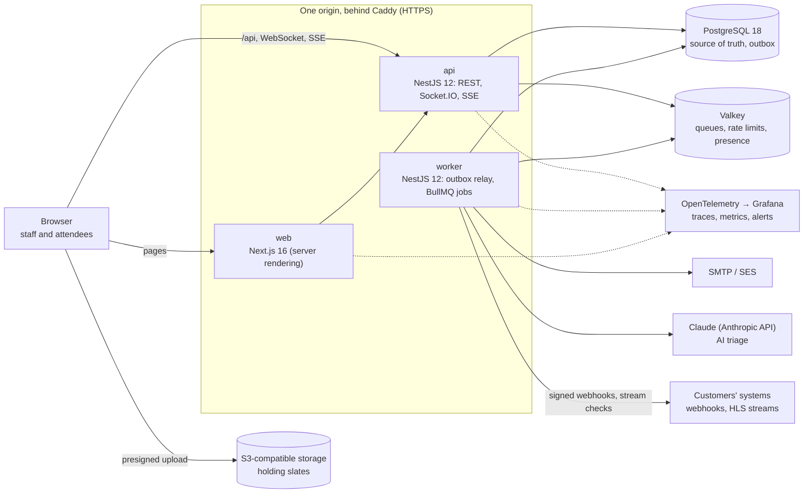

# GoLiveBoard

**An operations platform for teams running high-stakes online events:** product launches, customer conferences, company all-hands.

It answers the question operations teams struggle with most, **"is this event ready to go live?"**, and keeps the event under control while it runs: who is admitted, what the audience asks, whether the stream is healthy, and what happened afterwards.

> **Live demo:** coming with the AWS deployment (milestone 10). Until then, the [production-like stack](#try-it-in-five-minutes) runs the same images on your machine, demo workspace included.

**History.** GoLiveBoard was called OpsPilot until November 2026, so older commits use that name. This is its second version. The first was built in this repository from September to November 2026; the second was then written from a fresh design, milestone by milestone, in a separate repository, and its history merged here (commit `1f86d89`), so both are in `git log`. Its development was AI-assisted (Claude), as the commits' `Co-Authored-By` lines show; each milestone was reviewed independently, with mutation testing, before it was accepted ([docs/07](docs/07-delivery-plan.md)).

---

## What it does

One event, from preparation to the record afterwards (the "golden flow", [docs/01](docs/01-product-requirements.md#3-golden-flow)):

| Step        | Who                           | What GoLiveBoard does                                                                                                                                                                                                                                                                                                                                                                                                                         |
| ----------- | ----------------------------- | --------------------------------------------------------------------------------------------------------------------------------------------------------------------------------------------------------------------------------------------------------------------------------------------------------------------------------------------------------------------------------------------------------------------------------------------- |
| **Prepare** | Owner, Manager                | Create the event; in **Launch Control**, fill in the runbook, the access policy, the stream and the holding slate. They add up to a **readiness score**. A hard blocker (no reachable stream, say) stops the event from becoming ready or going live, even when two people press "go live" at the same moment                                                                                                                                 |
| **Admit**   | Attendees                     | A fast public event page, server-rendered. Registration with address verification; access policies (public, limited to email domains, or invitation-only) and invitations; reminders sent once; recorded consent; erasure on request                                                                                                                                                                                                          |
| **Run**     | Moderators, attendees         | Watch with live **chat and moderated Q&A** (votes, pins, answers), with no message lost or duplicated across reconnects. Access revoked mid-stream ends the connection within 5 seconds. **AI triage** groups questions that ask the same thing and suggests what to answer first; nothing changes until a moderator accepts, and Q&A carries on if the model fails. The **operations room** shows stream health, audience and incidents live |
| **Record**  | Owner, Manager, other systems | A **report** (registration funnel, audience, interaction) with CSV export; signed **webhooks** with retries; a searchable **audit trail** of every change                                                                                                                                                                                                                                                                                     |

---

## Try it in five minutes

You need Docker with Compose v2, Node.js 26 (see `.nvmrc`) and npm 11.

```bash
npm ci
npm run stack:up        # builds the production images and starts everything behind Caddy over HTTPS
```

Open <https://goliveboard.localhost:3443>.

The certificate comes from a local authority your browser does not trust yet, so either accept the warning or [trust the authority](docs/06-infrastructure-and-operations.md#14-production-like-stack).

**A quick tour: the demo workspace.**

1. Choose **Try the demo** on the sign-in page. You are now the Manager of a shared workspace with sample events, reset every night.
2. Open "Autumn product launch" in Launch Control. The readiness score and its blockers show what stands between the event and going live.
3. Open the event's public page (its link is under Audience) in another browser profile, and register with any address at `northwind.example`, the domain its access policy admits. No real email is sent: once you have registered, the page links to the **demo inbox**, where the confirmation link is.

The demo cannot go live: visitors may not set a stream URL (docs/06, section 10), so live chat and Q&A need the full run below.

**The whole golden flow, in a workspace of your own.**

1. **Sign up** on the stack. Its emails go to Mailpit at <http://127.0.0.1:8037>.
2. **Prepare:**
   - Create an event, and open it in Launch Control.
   - For the stream, use a public HLS test stream, for example Apple's `https://devstreaming-cdn.apple.com/videos/streaming/examples/img_bipbop_adv_example_fmp4/master.m3u8`.
   - Choose **Check now** in the Stream section: the stream counts as reachable after a check that succeeded within 5 minutes.
   - Clear the other blockers it lists (the access policy, the critical runbook tasks, a holding slate: a JPEG, PNG or WebP image) until the event is ready, then go live.
3. **Admit:** in another browser profile, open the public page, register, and confirm through the email in Mailpit.
4. **Run:**
   - Watch, chat and ask questions as the attendee.
   - As the Manager, moderate them, and try **AI suggestions** after asking the same question twice. The stack groups identical questions without a model (`AI_PROVIDER=offline`).
   - The operations room shows the stream, the audience and incidents.
5. **Record:** end the event, then open its **Report** and export the CSV. The audit trail has every change.

**See it from the inside:** Grafana at <http://127.0.0.1:3037> has the **GoLiveBoard overview** dashboard, its alerts, and a trace of every request.

`npm run test:e2e:stack` runs the browser tests against this stack; `npm run stack:down` stops it.

---

## Architecture

A **modular monolith** ([ADR-0002](docs/adr/0002-modular-monolith.md)) in three processes behind **one origin** ([ADR-0003](docs/adr/0003-single-origin.md)). Request and message shapes are **Zod schemas shared** by server and client ([ADR-0004](docs/adr/0004-shared-zod-contracts.md)).



**Key mechanisms:**

- **Writes are transactions in PostgreSQL.** Row and advisory locks guard the races that matter ([ADR-0006](docs/adr/0006-postgres-prisma-concurrency.md)): go-live against a blocker, votes and pins, the AI budget. Each is proven by a test that forces the overlap.
- **Side effects leave through a transactional outbox** ([ADR-0007](docs/adr/0007-transactional-outbox.md)). A change and the message about it commit together; the worker relays them to BullMQ queues (webhooks, AI triage, reminders, maintenance), whose jobs are safe to run twice.
- **Real time:**
  - **Socket.IO** carries chat and Q&A, with per-channel sequence journals, so a client that reconnects catches up with nothing lost or duplicated ([ADR-0008](docs/adr/0008-realtime-transports.md)).
  - **Server-sent events** feed the operations room.
- **Sessions:** HTTP-only cookies with rotating refresh tokens and reuse detection ([ADR-0005](docs/adr/0005-session-authentication.md)). Every request re-checks workspace and role; another workspace's resources are always `404`.
- **Observability:** OpenTelemetry traces follow a click from the browser through the API and the outbox into the worker's job, with metrics, dashboards and alerts as code ([ADR-0011](docs/adr/0011-observability.md)). Errors go to Sentry.

**In AWS** ([ADR-0010](docs/adr/0010-aws-deployment.md), [docs/06](docs/06-infrastructure-and-operations.md#5-aws-infrastructure-terraform)):

- **Compute and data:** one ARM EC2 host runs the containers; RDS PostgreSQL sits in private subnets; S3, SES and ECR; secrets in Parameter Store.
- **Delivery:** everything in Terraform. GitHub Actions deploys through OIDC (no stored keys) and SSM: migrations first, then a smoke test, and an automatic rollback to the previous images when it fails.

| Layer          | Technology                                                                                                                                       |
| -------------- | ------------------------------------------------------------------------------------------------------------------------------------------------ |
| Web            | Next.js 16, React 19, Tailwind CSS 4, shadcn/ui (Radix), TanStack Query, hls.js                                                                  |
| API and worker | NestJS 12 (ES modules), Prisma 7, BullMQ, Socket.IO, pino, Zod 4                                                                                 |
| Data           | PostgreSQL 18, Valkey, S3 (SeaweedFS locally)                                                                                                    |
| AI             | Official Anthropic SDK behind an interface of GoLiveBoard's own (`claude-opus-5-5` by default) ([ADR-0012](docs/adr/0012-ai-question-triage.md)) |
| Quality        | TypeScript 6 (strict), ESLint, Prettier, dependency-cruiser, Vitest, Testcontainers, Playwright, axe, Lighthouse CI, k6, ZAP                     |
| Operations     | Docker (multi-stage, non-root, amd64 and arm64), Caddy, OpenTelemetry, Grafana, Sentry, Terraform, GitHub Actions                                |

---

## Evidence

Claims you can check in this repository:

| Area                | What backs it                                                                                                                                                                                                                                                                                                            |
| ------------------- | ------------------------------------------------------------------------------------------------------------------------------------------------------------------------------------------------------------------------------------------------------------------------------------------------------------------------ |
| **Tests**           | <ul><li>900+ unit and component tests, with 90% coverage required on domain code.</li><li>560+ integration tests against real PostgreSQL, Valkey and S3 in containers.</li><li>Browser tests against the production images over HTTPS, on amd64 and arm64, in every CI run.</li></ul>                                    |
| **Tests that test** | Every fix lands with a regression test, checked by a mutation that must make it fail. The mutation lists were re-run by independent reviewers each milestone                                                                                                                                                             |
| **Concurrency**     | Race tests force the overlap with locks and gates; they do not hope for it                                                                                                                                                                                                                                               |
| **Performance**     | <ul><li>NFR-4 load test: 500 attendees, 20 chat messages per second, one API instance; delivery at p95 0.57 s ([record](docs/load-tests/2026-11-18-nfr4-local.md)).</li><li>Public page: Lighthouse performance 0.92–0.99, accessibility 1.00, LCP 0.8–1.0 s, INP under 100 ms ([record](docs/lighthouse.md)).</li></ul> |
| **Accessibility**   | WCAG 2.2 AA audit, criterion by criterion; a keyboard-only walkthrough of the golden flow, and reflow at 320 px, in CI ([audit](docs/accessibility-audit.md))                                                                                                                                                            |
| **Security**        | OWASP ASVS 5.0 level 2 review with ZAP scans ([review](docs/security-review.md)); SSRF protection on every outbound call; dependency audit, secret scan and image scan in CI                                                                                                                                             |
| **Operations**      | <ul><li>Six runbooks, each rehearsed: rollback, point-in-time restore, secret rotation, failing webhooks, false stream outages, failed demo reset ([runbooks](docs/runbooks/README.md)).</li><li>Five alert rules, each tested to fire past its threshold.</li></ul>                                                     |

---

## Trade-offs

Decisions made on purpose, and what they cost:

- **A modular monolith, not services.** One deployable, with module boundaries enforced by dependency-cruiser. Splitting later is a deployment change, because the modules talk through interfaces and the outbox. _Cost:_ the API and the worker scale together until then.
- **One EC2 host, not ECS and a load balancer.** It fits the demo's capacity and budget (about $35 a month). _Cost:_ a single point of failure for the application tier (the 99.5% objective allows it), and a few seconds unavailable per deploy. Docker restarts a container that exits, and a watchdog one that hangs. The containers are already production-shaped, so ECS Fargate, an ALB and ElastiCache need only infrastructure changes. [Production readiness](docs/production-readiness.md) compares every area with industry practice: what is at that level, what stops short and why, and in what order the rest would come.
- **Revocation by polling the database every second, not pub/sub.** "Access ends within 5 seconds" must hold even when a broker message is lost. _Cost:_ a small, constant query load per instance.
- **Chat delivered in 100 ms frames.** It cut the API's writes per message from one per attendee to one per attendee per frame, and made NFR-4 pass. _Cost:_ up to 100 ms more latency per message, still well within the 1 s objective.
- **The model sees labels (`q1…qN`), never IDs.** A made-up label fails validation instead of touching a real question. Nothing the model says changes anything until a moderator confirms. _Cost:_ one broken suggestion discards the whole set.
- **No OpenTelemetry SDK in the browser.** The browser starts the trace with a `traceparent` header of its own; the public page keeps its JavaScript budget (under 150 kB). _Cost:_ browser-side timing is not traced.

**Known limits, stated plainly:**

- **Not yet done by a person:** listening to the golden flow with a screen reader (planned before the public demo).
- **Not built:** a generated OpenAPI document.
- **Measured on a laptop:** the load test, and the runbook rehearsals, ran on the local stack. Both run again on AWS in milestone 10.

---

## Develop

```bash
cp .env.example .env     # local settings; adjust ports here if they clash
npm ci
npm run services:up      # PostgreSQL, Valkey, Mailpit, SeaweedFS (S3) and the Caddy proxy
npm run db:deploy        # apply database migrations
npm run dev              # web app, API, worker and contracts in watch mode
```

Open <http://localhost:3300> and create a workspace. Emails (invitations, password resets) appear in Mailpit at <http://localhost:8036>. The API answers on the same origin, for example <http://localhost:3300/api/v1/health/ready>.

| Command                                      | What it does                                                                                                      |
| -------------------------------------------- | ----------------------------------------------------------------------------------------------------------------- |
| `npm run check`                              | Formatting, lint, types and architecture rules                                                                    |
| `npm test`                                   | Unit and component tests                                                                                          |
| `npm run test:int`                           | API integration tests (starts its own containers; needs `openssl` on the PATH)                                    |
| `npm run build`, then `npm run test:e2e`     | Playwright against the production builds (needs `services:up` and `db:deploy`; it serves whatever was built last) |
| `npm run stack:up`, `npm run test:e2e:stack` | The production images over HTTPS, and the browser tests against them                                              |
| `npm run observability:up`                   | Grafana with traces, metrics, dashboards and alerts for local development                                         |
| `npm run load:nfr4`                          | The NFR-4 load test against the stack ([how](docs/load-tests/2026-11-18-nfr4-local.md))                           |
| `npm run db:seed`                            | Load the demo workspace, or put it back to its seed                                                               |

**Repository layout:**

```text
apps/api            NestJS API and worker (one codebase, two entry points), Prisma schema and migrations
apps/web            Next.js web app: public pages, the signed-in app, the watch page
packages/contracts  Zod schemas and error codes shared by both
e2e                 Playwright tests: the golden flow, accessibility, keyboard, layout, security, observability
infra               Dockerfile, Caddy, Grafana dashboards and alerts
load                k6 load test and its seed
docs                requirements, architecture, data model, API, standards, operations, plan, ADRs,
                    runbooks and the milestone 9 evidence
```

---

## Documentation

| Document                                                                  | What it covers                                                            |
| ------------------------------------------------------------------------- | ------------------------------------------------------------------------- |
| [Documentation index](docs/README.md)                                     | How the documents fit together, the order to read them, and the evidence  |
| [Product requirements](docs/01-product-requirements.md)                   | Problem, users, golden flow, functional and non-functional requirements   |
| [Architecture](docs/02-architecture.md)                                   | System context, components, technology choices, cross-cutting concerns    |
| [Domain and data model](docs/03-domain-and-data-model.md)                 | Modules, entities, invariants, state machines, data retention             |
| [API and contracts](docs/04-api-and-contracts.md)                         | REST conventions, endpoint catalogue, real-time protocols, webhooks       |
| [Engineering standards](docs/05-engineering-standards.md)                 | Code, testing, security, accessibility and review standards               |
| [Infrastructure and operations](docs/06-infrastructure-and-operations.md) | Local environment, CI/CD, AWS, observability, runbooks                    |
| [Delivery plan](docs/07-delivery-plan.md)                                 | Milestones, exit criteria and how they map to lessons                     |
| [Architecture decision records](docs/adr/README.md)                       | Why each significant decision was made                                    |
| [Production readiness](docs/production-readiness.md)                      | Each area against industry practice: what meets it, what stops short, why |

## Status

Milestones 1 to 9 are built and accepted: the whole golden flow, hardened with tracing, alerts, load, accessibility and security work. Milestone 10, deployment to AWS and the public launch, is in progress.
