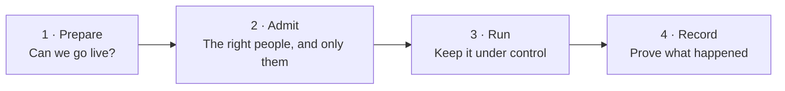

# 01 · Product requirements

## 1. Problem

Operations teams running high-stakes online events — product launches, customer conferences, company all-hands — prepare them across spreadsheets, chat threads and several tools.

- **Before the event**, nobody can say with confidence whether it is ready: is the stream link working, is the audience restricted correctly, has every critical task been done?
- **During the event**, problems surface late: a dead stream, a flood of duplicate questions, an attendee who should not be there.
- **Afterwards**, nobody can reconstruct who decided what, or show stakeholders how the event went.

GoLiveBoard gives the team one place to prepare, admit, run and record an event, and it refuses to go live while something critical is missing.

## 2. Users and roles

| Persona                        | Role in GoLiveBoard                 | What they need                                                                  |
| ------------------------------ | ----------------------------------- | ------------------------------------------------------------------------------- |
| Head of events at the customer | **Owner**                           | Set up the workspace, manage the team, everything a Manager can do              |
| Operations manager             | **Manager**                         | Prepare events, decide when to go live, moderate chat and Q&A, handle incidents |
| Analyst or stakeholder         | **Analyst**                         | Read-only access to events, readiness, the operations room and reports          |
| Person attending the event     | **Attendee** (no workspace account) | Register, verify their email, watch, chat and ask questions                     |

Staff (Owner, Manager, Analyst) are members of one or more **workspaces**; all data belongs to a workspace. Attendees belong to a single event.

## 3. Golden flow

1. **Prepare** — the team sets owners, the runbook, audience access, the stream link and a holding slate. Launch Control turns this evidence into a readiness score, checks that the stream is reachable, and blocks going live while a hard blocker remains.
2. **Admit** — attendees register on a fast public event page and verify their email. Access can be public, limited to email domains, or invitation-only. Registered attendees get reminders before the start.
3. **Run** — the watch page shows the customer's stream with chat and Q&A. AI groups duplicate questions and suggests what to answer next; a moderator always confirms. The operations room shows stream status, audience and incidents.
4. **Record** — every important decision is audited, the customer's systems receive signed webhooks, and a post-event report shows attendance, engagement and incidents.

## 4. Functional requirements

Each requirement has acceptance criteria written so they can become automated tests.

### 4.1 Workspace and team (`WS`)

| ID      | Requirement                                                                | Acceptance criteria                                                                                                                                                                                                                                                                                                                                                                                                                                           |
| ------- | -------------------------------------------------------------------------- | ------------------------------------------------------------------------------------------------------------------------------------------------------------------------------------------------------------------------------------------------------------------------------------------------------------------------------------------------------------------------------------------------------------------------------------------------------------- |
| FR-WS-1 | A visitor can sign up, which creates a workspace and makes them its Owner. | Sign-up with name, email and password creates one workspace, one user and an Owner membership in a single transaction. An email already registered returns the same response as a new one and sends a "you already have an account" email (no account enumeration). Where the deployment sets invite codes (`SIGN_UP_CODES`, as the public demo does), sign-up also needs a valid code; without one it fails with `SIGN_UP_CODE_INVALID` and creates nothing. |
| FR-WS-2 | An Owner can invite people by email with a role.                           | The invitee receives a one-time link valid for 7 days. Accepting it creates the user (if needed) and the membership. A used, expired or revoked link is rejected.                                                                                                                                                                                                                                                                                             |
| FR-WS-3 | An Owner can change a member's role or remove them.                        | The change takes effect on the member's **next request**, even with an unexpired access token. The last Owner cannot be removed or demoted.                                                                                                                                                                                                                                                                                                                   |
| FR-WS-4 | A user who belongs to several workspaces can switch between them.          | Every request is scoped to the active workspace; data from another workspace is never returned (tested per endpoint).                                                                                                                                                                                                                                                                                                                                         |

### 4.2 Authentication (`AUTH`)

| ID        | Requirement                                                                             | Acceptance criteria                                                                                                                                                                                              |
| --------- | --------------------------------------------------------------------------------------- | ---------------------------------------------------------------------------------------------------------------------------------------------------------------------------------------------------------------- |
| FR-AUTH-1 | Staff sign in with email and password.                                                  | Wrong email and wrong password produce identical responses and similar timing. Ten failed attempts per account or IP within 15 minutes are throttled.                                                            |
| FR-AUTH-2 | Sessions use a short-lived access token and a rotating refresh token.                   | Access token lifetime 15 minutes; refresh token 7 days, single-use. Reusing a refresh token revokes the whole session. Two concurrent refreshes with the same token produce exactly one success.                 |
| FR-AUTH-3 | Staff can sign out, and an Owner can sign a member out everywhere.                      | Sign-out revokes the session; its refresh token stops working immediately.                                                                                                                                       |
| FR-AUTH-4 | Staff can reset a forgotten password by email.                                          | The reset link is single-use and valid for 30 minutes; using it revokes all other sessions. The request endpoint does not reveal whether the email exists.                                                       |
| FR-AUTH-5 | A one-click **demo login** signs a visitor into the shared demo workspace as a Manager. | Available only when demo mode is enabled. The demo workspace is reset nightly. In demo mode, emails are captured and never delivered to real addresses, and webhooks can only target the built-in test receiver. |

### 4.3 Events (`EV`)

| ID      | Requirement                                                                                                         | Acceptance criteria                                                                                                                                                                                            |
| ------- | ------------------------------------------------------------------------------------------------------------------- | -------------------------------------------------------------------------------------------------------------------------------------------------------------------------------------------------------------- |
| FR-EV-1 | Managers create and edit events: title, description, start and end time with time zone, owner, expected attendance. | Times are stored in UTC and displayed in the event's time zone. End must be after start. Edits use optimistic concurrency: an edit based on an old version is rejected with `412`.                             |
| FR-EV-2 | Events follow a lifecycle.                                                                                          | `DRAFT → CONFIGURING → READY → LIVE → COMPLETED → ARCHIVED`, plus `CANCELLED` from any state before `LIVE`. Any other transition is rejected with `409`. Every transition is audited and emits a domain event. |
| FR-EV-3 | Staff can list events.                                                                                              | Search by title, filter by status and date range, sorted by start time, cursor-paginated.                                                                                                                      |
| FR-EV-4 | Archived events are read-only.                                                                                      | Every write to an archived event, or anything belonging to it, is rejected with `409`.                                                                                                                         |

### 4.4 Launch Control (`LC`)

| ID      | Requirement                                                                                                      | Acceptance criteria                                                                                                                                                                                            |
| ------- | ---------------------------------------------------------------------------------------------------------------- | -------------------------------------------------------------------------------------------------------------------------------------------------------------------------------------------------------------- |
| FR-LC-1 | Managers maintain a runbook per event: tasks with owner, due time, status and a "critical" flag.                 | Tasks can be reordered, completed and reopened. Completion records who and when.                                                                                                                               |
| FR-LC-2 | Launch Control calculates a readiness score from 0 to 100 from versioned rules.                                  | Each criterion shows its score, its maximum and the **evidence** behind it. The same inputs always give the same score (pure function, unit-tested per rule). The rule version is stored with each assessment. |
| FR-LC-3 | Some criteria are **hard blockers**: no access policy, stream unreachable, critical task open, no holding slate. | `CONFIGURING → READY` and `READY → LIVE` are rejected with `409` and the list of blockers while any hard blocker remains — **including when two requests race** (tested).                                      |
| FR-LC-4 | Launch Control lists the next actions that would raise the score.                                                | Derived deterministically from failing criteria, ordered by impact; each links to where it is fixed.                                                                                                           |

### 4.5 Stream and assets (`ST`)

| ID      | Requirement                                                                                                                        | Acceptance criteria                                                                                                                                                                                                              |
| ------- | ---------------------------------------------------------------------------------------------------------------------------------- | -------------------------------------------------------------------------------------------------------------------------------------------------------------------------------------------------------------------------------- |
| FR-ST-1 | Managers set the event's stream: an HLS playback URL from the customer's provider (for example Mux, AWS IVS or Cloudflare Stream). | Only `https` URLs are accepted. The URL is validated against an SSRF-safe allow policy (no private or link-local addresses).                                                                                                     |
| FR-ST-2 | The stream is checked automatically.                                                                                               | From 60 minutes before the start until the end, a worker fetches the manifest every 30 seconds. Two consecutive failures open an **incident**; two consecutive successes resolve it. The check result feeds the readiness score. |
| FR-ST-3 | Managers upload a holding slate image shown to attendees before the stream starts.                                                 | Upload goes directly to object storage via a presigned URL. JPEG, PNG or WebP, at most 5 MB, verified after upload.                                                                                                              |

### 4.6 Audience admission (`AD`)

| ID      | Requirement                                                                              | Acceptance criteria                                                                                                                                                                                                                                                              |
| ------- | ---------------------------------------------------------------------------------------- | -------------------------------------------------------------------------------------------------------------------------------------------------------------------------------------------------------------------------------------------------------------------------------- |
| FR-AD-1 | Each event has a public page, rendered on the server.                                    | Contains title, time in the visitor's time zone, description and the registration form. Correct Open Graph metadata for link previews. Meets the performance budget in NFR-3.                                                                                                    |
| FR-AD-2 | Managers choose the access policy: public, limited to email domains, or invitation-only. | The policy is enforced at registration **and** re-checked on every attendee request, so a change takes effect immediately.                                                                                                                                                       |
| FR-AD-3 | Attendees register with name and email and verify the email.                             | The verification link is single-use, valid for 15 minutes and stored only as a hash. The registration response is identical whether or not the email is eligible or already registered.                                                                                          |
| FR-AD-4 | For invitation-only events, Managers invite and revoke attendees.                        | Revoking access ends the attendee's live session within 5 seconds (chat, Q&A and stream access).                                                                                                                                                                                 |
| FR-AD-5 | Registered, verified attendees receive reminders 24 hours and 1 hour before the start.   | Sent at most once each, even if the job runs twice. Not sent to attendees who withdrew consent or whose access was revoked.                                                                                                                                                      |
| FR-AD-6 | Consent and data rights follow UK GDPR.                                                  | The registration form shows the privacy notice and records its version. Attendee personal data is deleted or anonymised 90 days after the event ends (configurable per workspace). A Manager can erase one attendee on request; their chat messages remain as "Former attendee". |

### 4.7 Running the event (`RN`)

| ID      | Requirement                                                                                  | Acceptance criteria                                                                                                                                                                                                                                                                                                                                                                                     |
| ------- | -------------------------------------------------------------------------------------------- | ------------------------------------------------------------------------------------------------------------------------------------------------------------------------------------------------------------------------------------------------------------------------------------------------------------------------------------------------------------------------------------------------------- |
| FR-RN-1 | The watch page shows the holding slate before the event is `LIVE` and the stream once it is. | Switches automatically on the `LIVE` transition without a reload. Only verified, eligible attendees and staff can open it.                                                                                                                                                                                                                                                                              |
| FR-RN-2 | Attendees and staff chat in real time.                                                       | Messages appear for everyone within 1 second (p95, same region). After a dropped connection the client catches up with **no lost and no duplicated messages** (tested with network interruption). Retrying a send never creates a duplicate.                                                                                                                                                            |
| FR-RN-3 | Managers moderate chat.                                                                      | Deleting a message removes its text for everyone, keeps a tombstone and is audited.                                                                                                                                                                                                                                                                                                                     |
| FR-RN-4 | Attendees ask questions and upvote others.                                                   | One vote per attendee per question. Optional pre-moderation: new questions are visible only to their author and moderators until approved.                                                                                                                                                                                                                                                              |
| FR-RN-5 | Managers moderate Q&A: approve, hide, mark answered, pin (at most 3 pinned).                 | Concurrent edits are rejected with `412` rather than overwritten. The pin limit holds under concurrent requests (database-enforced).                                                                                                                                                                                                                                                                    |
| FR-RN-6 | **AI Q&A triage** groups duplicate questions and suggests which to answer next.              | Suggestions are structured (group, representative question, reason) and refer only to existing question IDs. Nothing changes until a moderator confirms. If the AI provider fails or times out (8 seconds), Q&A works normally and the panel says suggestions are unavailable. Each run records model, latency, token usage and cost. An evaluation suite in CI checks grouping quality on fixed cases. |
| FR-RN-7 | The operations room shows the live state of the event.                                       | Stream status, current audience (from attendee heartbeats every 30 seconds), message and question rates, open incidents and a timeline of key moments. Updates arrive by server-sent events within 2 seconds.                                                                                                                                                                                           |

### 4.8 Record (`RC`)

| ID      | Requirement                                                                             | Acceptance criteria                                                                                                                                                                                                                                                                                                                                                                                 |
| ------- | --------------------------------------------------------------------------------------- | --------------------------------------------------------------------------------------------------------------------------------------------------------------------------------------------------------------------------------------------------------------------------------------------------------------------------------------------------------------------------------------------------- |
| FR-RC-1 | Important actions are audited: who, what, when, and before/after values where relevant. | Written in the same transaction as the change. Searchable by actor, action, event and date. Never contains secrets or attendee email addresses in clear text.                                                                                                                                                                                                                                       |
| FR-RC-2 | Owners configure webhook endpoints for event types.                                     | Payloads are signed with HMAC-SHA256 and a timestamp. Failed deliveries are retried up to 5 times with exponential backoff. Every attempt is logged; a failed delivery can be resent manually. The signing secret is shown once.                                                                                                                                                                    |
| FR-RC-3 | Each completed event has a report.                                                      | Registration funnel (registered → verified → attended), peak and average concurrent audience, audience over time with incidents marked, questions asked and answered, chat volume. Exportable as CSV.                                                                                                                                                                                               |
| FR-RC-4 | Staff compare their completed events over a span.                                       | Every role sees, for completed events that started in a span of up to three years (the last twelve months by default): totals (events, registered, verified, attended, highest and average peak audience, questions asked and answered, chat messages, incidents), the same month by month, and one row per event linking to its report. Exportable as CSV. Another workspace's events never count. |

## 5. Non-functional requirements

| ID     | Area            | Requirement                                                                                                                                                                                                                                                                                                                                                                                      |
| ------ | --------------- | ------------------------------------------------------------------------------------------------------------------------------------------------------------------------------------------------------------------------------------------------------------------------------------------------------------------------------------------------------------------------------------------------ |
| NFR-1  | Security        | Follows OWASP ASVS level 2 for the areas in scope. Passwords hashed with Argon2id. Cookies `HttpOnly`, `Secure`, `SameSite=Lax`. State-changing requests require a matching `Origin`. All input validated against shared schemas. Authorisation re-checked on every request from current membership. Security headers including a Content Security Policy. Dependency and secret scanning in CI. |
| NFR-2  | Privacy         | UK GDPR: data minimisation, recorded consent, retention limits, erasure on request. Logs and traces contain no passwords, tokens or attendee email addresses.                                                                                                                                                                                                                                    |
| NFR-3  | Performance     | Public event page: Largest Contentful Paint under 2.5 s and Interaction to Next Paint under 200 ms at the 75th percentile (Core Web Vitals "good"). API read endpoints under 300 ms at p95 at the target load.                                                                                                                                                                                   |
| NFR-4  | Capacity        | One event with 500 concurrent attendees and 20 chat messages per second on a single API instance, verified with a load test before the public demo.                                                                                                                                                                                                                                              |
| NFR-5  | Reliability     | No lost or duplicated chat messages or questions across reconnects. Writes that clients retry are idempotent. Background jobs retry with backoff and are safe to run twice. Graceful shutdown drains in-flight work.                                                                                                                                                                             |
| NFR-6  | Accessibility   | WCAG 2.2 level AA. Automated axe checks on every page in CI; keyboard-only walkthrough of the golden flow before each release.                                                                                                                                                                                                                                                                   |
| NFR-7  | Observability   | Structured JSON logs with request and trace IDs. One trace follows a request from the browser through the API to the worker. Errors reported to Sentry with release tags. Liveness and readiness endpoints.                                                                                                                                                                                      |
| NFR-8  | Maintainability | Strict TypeScript, linting and formatting enforced in CI. Domain rules covered by unit tests. Significant decisions recorded as ADRs.                                                                                                                                                                                                                                                            |
| NFR-9  | Deployability   | One command starts the local environment. Infrastructure defined in Terraform. Every merge to `main` builds immutable images and deploys them through the pipeline; no manual changes in the console.                                                                                                                                                                                            |
| NFR-10 | Browser support | The latest two versions of Chrome, Edge, Firefox and Safari, on desktop and mobile.                                                                                                                                                                                                                                                                                                              |

## 6. Out of scope

- Billing, subscriptions and self-service payment.
- Single sign-on (SAML, OIDC) for staff.
- Native mobile apps.
- Hosting, recording or transcoding video — GoLiveBoard works with the customer's streaming provider.
- Polls, breakout rooms and networking features.
- User interface languages other than English.

## 7. Success measures

The product is succeeding when, for a typical customer event:

- the team reaches `READY` with no hard blockers before the start;
- the operations room shows a stream outage within 60 seconds of it starting;
- moderators handle the question backlog without losing questions;
- the report is available as soon as the event is `COMPLETED`.
