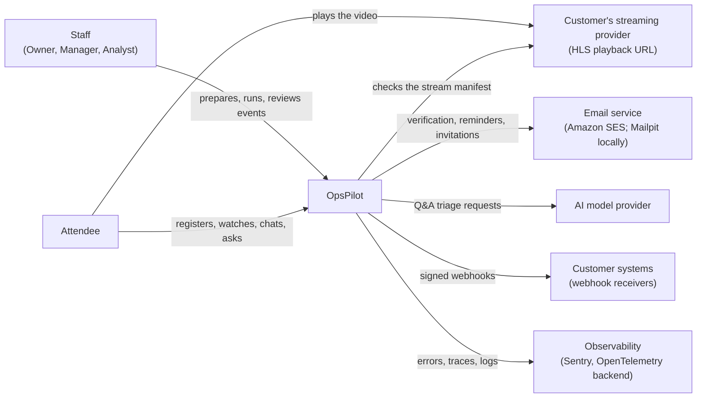
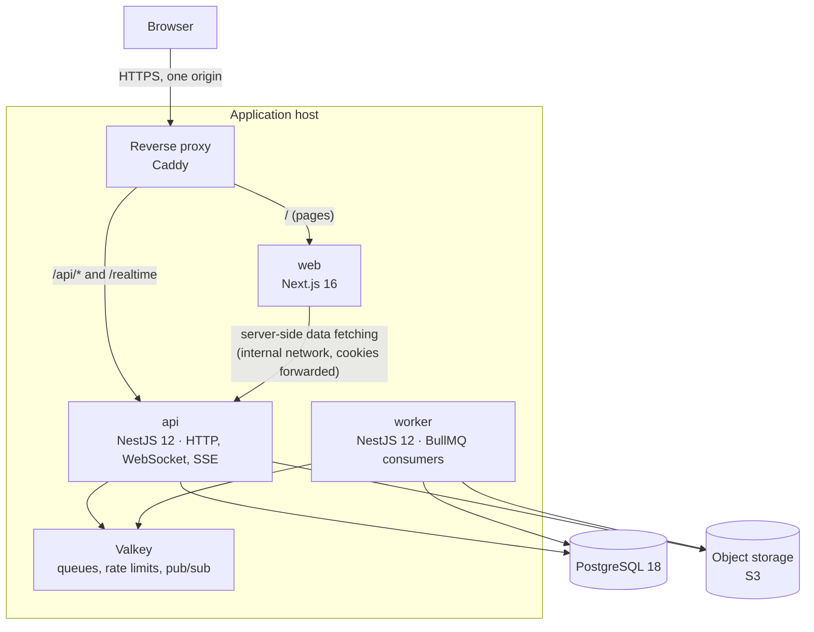
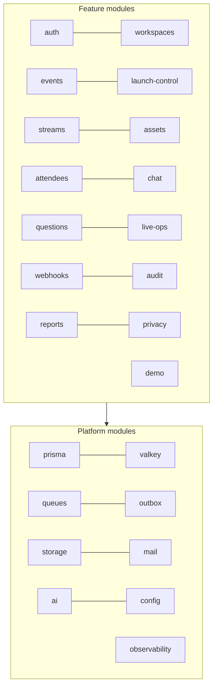
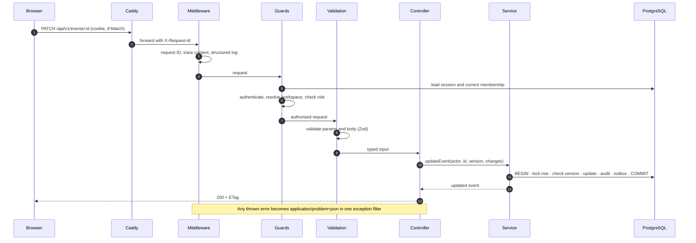
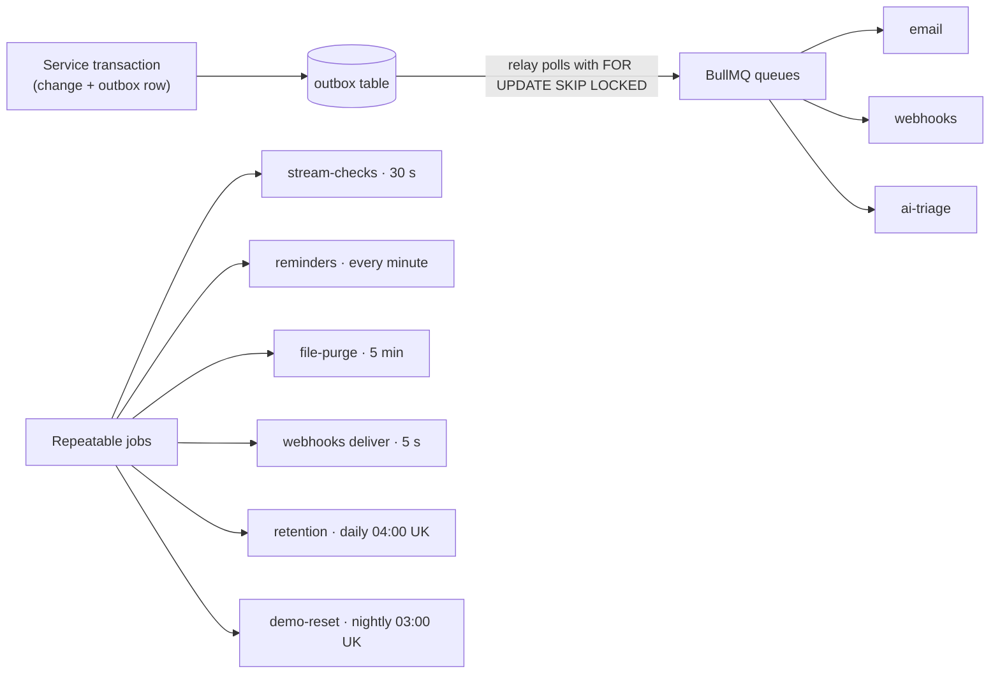
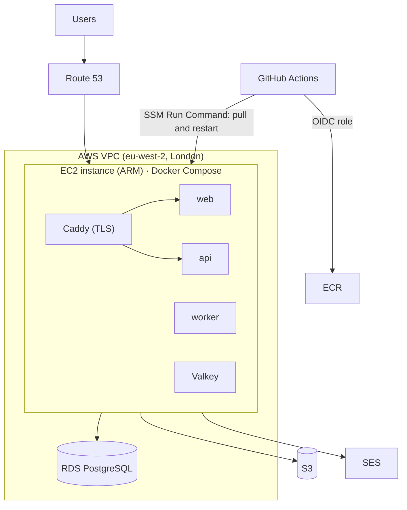

# 02 · Architecture

## 1. Overview

OpsPilot is a **modular monolith**: one TypeScript codebase for the backend, deployed as two processes (an HTTP/real-time API and a background worker), plus a Next.js web application. A reverse proxy serves everything from **one origin**, so the browser never makes cross-origin requests and cookies stay simple.

The design favours a small number of well-understood moving parts. Each one is there because a requirement needs it; the reasons are recorded in the [ADRs](adr/README.md).

## 2. System context



Attendees' browsers fetch video **directly from the customer's provider**. OpsPilot never carries video traffic; it only checks that the stream is reachable ([ADR-0009](adr/0009-stream-provider-integration.md)).

## 3. Containers



| Container      | Responsibility                                                                                     | Scales by                                                                    |
| -------------- | -------------------------------------------------------------------------------------------------- | ---------------------------------------------------------------------------- |
| **proxy**      | TLS termination, routing by path, compression, security headers shared by all responses            | One per host                                                                 |
| **web**        | Server-rendered public pages, the staff application shell, client-side interactivity               | Stateless; more instances                                                    |
| **api**        | REST API, Socket.IO gateway, server-sent events, authentication and authorisation                  | Stateless; more instances behind the proxy, real-time fan-out through Valkey |
| **worker**     | Outbox relay, email, webhooks, stream checks, reminders, AI triage, retention, reports, demo reset | More instances; BullMQ distributes jobs                                      |
| **PostgreSQL** | The system of record, including the real-time message journals                                     | Vertical, then read replicas if ever needed                                  |
| **Valkey**     | Job queues, rate-limit counters, Socket.IO adapter, cross-instance notifications                   | Single node at target scale                                                  |
| **S3**         | Holding slate images and report exports                                                            | Managed                                                                      |

`api` and `worker` are built from the same package (`apps/api`) with two entry points, so they share modules, types and tests ([ADR-0002](adr/0002-modular-monolith.md)).

## 4. Technology choices

**Version policy**: use the latest stable major of each tool, unless its ecosystem cannot support it yet; such exceptions are listed below the table with the condition for upgrading. Versions were checked in November 2026; exact versions are pinned by the lock file and Docker image tags.

| Area           | Choice                                                                             | Why                                                                                                                                                                                                     |
| -------------- | ---------------------------------------------------------------------------------- | ------------------------------------------------------------------------------------------------------------------------------------------------------------------------------------------------------- |
| Runtime        | **Node.js 26 LTS**                                                                 | The current Active LTS line, supported until April 2029.                                                                                                                                                |
| Language       | **TypeScript 6.0**, strict (see exceptions)                                        | One language across the stack; shared types end to end.                                                                                                                                                 |
| Repository     | **npm workspaces** monorepo                                                        | One install, one lock file, shared packages, no extra tool to learn.                                                                                                                                    |
| Web            | **Next.js 16.4** (App Router), **React 19.3**                                      | Server Components for fast public pages; client components where interaction needs them.                                                                                                                |
| UI             | **Tailwind CSS 4.3**, **shadcn/ui** (Radix primitives)                             | Accessible primitives we own as code; consistent design tokens.                                                                                                                                         |
| Client data    | **TanStack Query 5**                                                               | Caching, revalidation and mutation state for interactive staff screens.                                                                                                                                 |
| Forms          | **React Hook Form** + Zod resolver                                                 | The same schema validates in the browser and on the server.                                                                                                                                             |
| Charts         | **Plain SVG** (one small component)                                                | The operations room and report need per-minute line charts only; a chart library would cost most of the 150 kB script budget. Each chart is one named image with a summary, and its figures as a table. |
| API            | **NestJS 12** (ES modules)                                                         | Modules, dependency injection and lifecycle hooks suit a growing modular monolith; native Standard Schema validation works with Zod.                                                                    |
| Contracts      | **Zod 4.6** in `packages/contracts`                                                | Single source of truth for request and response shapes, real-time events and, once built, the OpenAPI document ([ADR-0004](adr/0004-shared-zod-contracts.md)).                                          |
| Database       | **PostgreSQL 18**                                                                  | Transactions, row locks, partial unique indexes and `SKIP LOCKED` cover the hard consistency requirements; built-in `uuidv7()`. Supported by Amazon RDS.                                                |
| Data access    | **Prisma ORM 7.10** with the `pg` driver adapter (see exceptions)                  | Typed queries and migrations; raw SQL where locks or aggregates need it ([ADR-0006](adr/0006-postgres-prisma-concurrency.md)).                                                                          |
| Queues         | **BullMQ 6** on **Valkey 9**                                                       | Retries, backoff, delayed and repeatable jobs; Valkey is the open-source Redis fork that Amazon ElastiCache offers.                                                                                     |
| Real-time      | **Socket.IO** for chat and Q&A; **server-sent events** for the operations room     | Two-way messaging where needed, simple one-way streaming where not ([ADR-0008](adr/0008-realtime-transports.md)).                                                                                       |
| Video          | **hls.js** in the watch page                                                       | Plays the customer's HLS stream in every supported browser.                                                                                                                                             |
| AI             | **Anthropic SDK 1.4** behind OpsPilot's `TriageModel` interface                    | Structured output validated by Zod; another provider is another implementation of the interface ([ADR-0012](adr/0012-ai-question-triage.md)).                                                           |
| Email          | **Nodemailer** → Amazon SES; **Mailpit** locally                                   | Standard SMTP locally, managed sending in production.                                                                                                                                                   |
| Object storage | **Amazon S3**; **SeaweedFS** locally                                               | MinIO's community edition is archived; SeaweedFS is an Apache-licensed S3-compatible replacement for local use.                                                                                         |
| Testing        | **Vitest 5**, Testing Library, **Playwright**, axe-core                            | One unit-test runner for every workspace; browser tests for the golden flow and accessibility.                                                                                                          |
| Observability  | **pino**, **OpenTelemetry**, **Sentry**                                            | Vendor-neutral traces across web, API and worker ([ADR-0011](adr/0011-observability.md)).                                                                                                               |
| Infrastructure | **Terraform**, **AWS** (EC2, RDS, S3, SES, ECR, SSM), **GitHub Actions** with OIDC | Reproducible, reviewable infrastructure at portfolio cost ([ADR-0010](adr/0010-aws-deployment.md)).                                                                                                     |

**Exceptions to the latest-major rule**

| Tool       | Latest                           | We use               | Why                                                                                                                                                                                             | Upgrade when                                                                                                |
| ---------- | -------------------------------- | -------------------- | ----------------------------------------------------------------------------------------------------------------------------------------------------------------------------------------------- | ----------------------------------------------------------------------------------------------------------- |
| TypeScript | 7.0 (native compiler, July 2026) | 6.0                  | 7.0 has no stable programmatic API yet, so `typescript-eslint` (which supports TypeScript below 6.1) cannot run on it. The native `tsgo` checker may be used locally for speed alongside `tsc`. | TypeScript 7.1 ships its stable API and `typescript-eslint` supports it                                     |
| Prisma ORM | 8.0 (release candidate)          | 7.10 (latest stable) | Release candidates are not used in production code. Prisma 7 receives fixes for 12 months after 8.0.                                                                                            | Prisma 8.0 is stable and its PostgreSQL extension covers our queries; evaluate in the learning folder first |

## 5. Repository layout

```text
opspilot/
├── apps/
│   ├── web/                 Next.js application
│   └── api/                 NestJS: src/main.ts (api), src/worker.ts (worker), prisma/ (schema, migrations)
├── packages/
│   └── contracts/           Zod schemas, inferred types, error codes, event names
├── e2e/                     Playwright tests for the whole system
├── infra/
│   ├── docker/              Dockerfiles, Caddyfile
│   └── terraform/           AWS infrastructure
├── docs/                    this documentation and ADRs
├── docker-compose.yml       local services
└── .github/workflows/       CI and deployment pipelines
```

## 6. Backend structure

### 6.1 Modules



- **Feature modules** own one business area each. A feature module may call another feature module's exported service, never its database tables directly.
- **Platform modules** wrap infrastructure (database, queues, storage, email, AI) behind small interfaces, so features can be tested with fakes.

### 6.2 Layers inside a feature module

| Layer       | File naming                                               | Rules                                                                                                                                               |
| ----------- | --------------------------------------------------------- | --------------------------------------------------------------------------------------------------------------------------------------------------- |
| Transport   | `*.controller.ts`, `*.gateway.ts`                         | Parse and validate input, call one service method, map the result. No business rules.                                                               |
| Application | `*.service.ts`                                            | One method per use case. Opens the transaction, checks authorisation, loads data, calls domain functions, writes, records audit and outbox entries. |
| Domain      | `domain/*.ts`                                             | Pure functions and types: state machines, readiness rules, eligibility. No framework imports, no I/O. Unit-tested exhaustively.                     |
| Data access | Prisma client inside services; `*.queries.ts` for raw SQL | Every query is scoped by `workspaceId`. Locks and aggregates in named, tested SQL.                                                                  |

### 6.3 Request lifecycle



## 7. Cross-cutting concerns

### 7.1 Authentication and sessions

- **Staff** sign in with email and password. The API issues a 15-minute **access token** (JWT, `HttpOnly` cookie) and a 7-day **refresh token** (random, stored as a SHA-256 hash, `HttpOnly` cookie restricted to the refresh path).
- Refresh tokens **rotate** on every use. A conditional update marks the old token used and issues the new one atomically; reusing an old token revokes the whole session family ([ADR-0005](adr/0005-session-authentication.md)).
- The access token only identifies the session. **Roles are never trusted from the token**: every request reloads the session and current membership, so revocations and role changes apply immediately.
- **Attendees** receive a separate session after email verification (opaque token, hashed in the database). Eligibility is re-checked on every attendee request and on every real-time subscription.
- **CSRF**: cookies are `SameSite=Lax`, the API accepts only JSON bodies, and every state-changing request must carry an `Origin` header matching the application origin.

### 7.2 Authorisation

Two checks on every request: **who** (session valid, user or attendee active) and **may they** (role in the active workspace, or attendee eligibility for this event). Role requirements are declared on controller methods; resource ownership (`workspaceId`) is enforced in every query. Cross-workspace access is covered by tests for each endpoint.

### 7.3 Validation and contracts

All request bodies, query strings, route parameters, real-time messages and job payloads are validated with schemas from `packages/contracts`. The web app uses the same schemas in forms. An OpenAPI 3.1 document generated from them is planned, not built yet ([docs/04, section 7](04-api-and-contracts.md#7-openapi-document)).

### 7.4 Consistency and concurrency

| Problem                                                  | Mechanism                                                                                                          |
| -------------------------------------------------------- | ------------------------------------------------------------------------------------------------------------------ |
| Two people edit the same record                          | Optimistic concurrency: `version` column, `ETag` on reads, `If-Match` on writes, `412` on mismatch                 |
| Two transitions race (e.g. "go live" twice)              | Pessimistic lock: `SELECT … FOR UPDATE` on the event row, then re-check rules inside the transaction               |
| A client retries a create after a timeout                | `Idempotency-Key` header stored with the response for 24 hours; chat uses a client-generated message ID            |
| A limit must hold under concurrency (3 pinned questions) | Database constraint: partial unique index on `(event_id, pin_slot)`                                                |
| A side effect must happen exactly when a change commits  | Transactional outbox: the change and the outbox row commit together ([ADR-0007](adr/0007-transactional-outbox.md)) |
| Real-time clients must not miss or duplicate messages    | Per-event sequence numbers and a journal table; clients resume from their last sequence                            |

### 7.5 Background work



Webhooks have a queue of their own, so a slow receiver (10 s per attempt) never holds up reminders or retention. An `event.transitioned` or `attendee.verified` message fans out to one delivery per subscribed, active endpoint (unique per endpoint and message). Every 5 s the worker takes due deliveries with `FOR UPDATE SKIP LOCKED`, moving each one's next attempt a minute ahead as a lease, so no other worker takes it while it is being sent. It then sends them signed, through the same address checks as stream checks, records the attempt, and schedules the next one (about 1, 5, 30 and 120 minutes) or marks the delivery failed after five.

Every job is **idempotent**: it checks whether its effect already happened before acting. A reminder, for example, is recorded in `reminder_deliveries` (one row per attendee and kind) in the transaction that decides to send it, before it is sent, so a job that runs twice, or on two workers, sends it at most once. Failed jobs retry with exponential backoff; jobs that exhaust their retries are kept and visible to operators.

No wait on a dependency is unbounded, because a frozen dependency (one that accepts connections but never answers) would otherwise hold a request, a database lock or the process forever:

- **Valkey, adding jobs**: each command times out after 2 s, and a connection that stays silent for 2 s with commands outstanding is dropped, which fails them and reconnects, so unanswered commands cannot pile up. A failed publish rolls the relay's round back, leaving the messages in the outbox.
- **Valkey, shutdown**: each queue and worker gets 3 s to close cleanly and is then disconnected by force.
- **Object storage**: each attempt times out after 5 s and each call, retries included, after 6 s. Completing an upload has 20 s for all its storage calls, inside its 30 s transaction, so storage gives up before the database does and the locks are released by a normal rollback. A storage timeout answers `503 SERVICE_UNAVAILABLE`.

### 7.6 Real-time

- **Chat and Q&A** use Socket.IO on `/realtime`, WebSocket only (so `Origin` is always checked and no instance needs sticky sessions). The browser's cookies authenticate the connection, with the same session loaders as HTTP. Each event has rooms per channel, and Q&A adds rooms for moderators and for each author, who see pending and hidden questions. Every change gets a per-event sequence number and a journal row in the same transaction; after a reconnect the client sends its last sequence and receives what it missed before live updates resume (docs/04, section 4).
- **Operations room** uses server-sent events with `Last-Event-ID`, because data only flows from server to browser. Each stream reads the database every second (changes, and the viewer's access) instead of listening for messages, so every instance sees the same and nothing is lost; a reconnect starts from a fresh snapshot (docs/04, section 5).
- With more than one API instance, the Socket.IO Valkey adapter fans messages out. Changes to who may take part (revocation, erasure, policy, status, sign-out, membership, role, workspace switch, the demo reset) write an `access_changes` row in their own transaction, from the API or the worker; every instance reads the last two minutes of them every second (skipping those it has acted on: rows can commit out of ID order), re-checks the connections concerned and disconnects those no longer allowed; a change counts as done only when everything it asked for worked, so a transient failure is tried again a second later. Nothing here depends on Valkey, so a lost message or a Valkey outage cannot delay a revocation past seconds. Rows are deleted after an hour. A sweep re-checks every connection every 30 seconds, for expired sessions. A session's connections are bounded across instances by slots taken atomically in Valkey (a Lua script timed by Valkey's own clock, so instances' clocks may drift), refreshed while they live (a dropped slot is taken back only under the limit; a connection that cannot take it back is closed), and stale after a minute. Shutdown disconnects only the instance's own clients, which reconnect elsewhere. Channel names carry `REALTIME_CHANNEL_PREFIX`, so deployments sharing a Valkey do not hear each other.

### 7.7 Errors

Every error response uses `application/problem+json` (RFC 9457) with a stable `code` from `packages/contracts` (for example `EVENT_HAS_BLOCKERS`, `VERSION_CONFLICT`). Unexpected errors return a generic `500` with the request ID; details go to logs and Sentry, never to the client.

In the browser, a rendering error stays as small as it can:

- **One part of a page:** each part of Launch Control, the watch page's video, chat and questions, and the operations room's figures, chart and timeline sits in its own error boundary (`components/error-boundary.tsx`). A part that fails says so and offers "Try again"; the rest keeps working. A broken chart never hides an incident.
- **A whole page:** a page that fails keeps its layout (`error.tsx` per route group), so the header and navigation stay.
- **The root layout:** when it fails, `global-error.tsx` replaces it.
- **Reporting:** each caught error is handed to `window.reportError`, so the lazily loaded Sentry reports it like an uncaught one. An error rendered on the server carries a `digest` and is not reported again, because the server reported it already.

### 7.8 Configuration and secrets

Each process validates its environment with a Zod schema at startup and refuses to start if anything is missing or malformed. Secrets come from environment variables locally and from AWS Systems Manager Parameter Store in production. Webhook signing secrets are encrypted at rest with AES-256-GCM.

### 7.9 Observability

- **Logs**: pino, JSON, one line per event, with the request ID (`req.id`, also returned to the client as `X-Request-Id`), the `trace_id` and `span_id` it was written in, `workspaceId` (on every line of a signed-in request, also when it is refused) and no personal data.
- **Traces**: OpenTelemetry in web (server side), api and worker ([ADR-0011](adr/0011-observability.md)). The browser starts a trace with a W3C `traceparent` header on its API calls (no browser SDK). Context travels through HTTP headers, the outbox (each message stores the trace it was written in) and BullMQ jobs (`bullmq-otel`), so one trace shows a click, the request and the jobs its outbox messages started (a webhook's fan-out among them). Work that runs on a schedule of its own starts its own trace, linked by IDs, not by trace: each webhook delivery attempt (`webhook.send`, minutes or hours later, with the delivery's and the endpoint's IDs), stream checks, reminders and the demo reset. Spans are redacted before they leave: no query strings, client addresses, Valkey arguments or SQL values.
- **Metrics**: OpenTelemetry metrics for HTTP rate, errors and duration per route, queue depth and age, outbox age, real-time connections, stream checks and webhook attempts; dashboards and alerts are provisioned from `infra/observability/grafana/` ([docs/06, section 7](06-infrastructure-and-operations.md#7-observability)).
- **Errors**: Sentry in the browser, web server, api and worker, tagged with the release and the process. In the api and worker, every log line at `error` or above that carries an error (`{ err }`) is reported, through a hook in the one pino logger, so an error is reported where it is logged and nowhere else; each kind of error at most once a minute, so an outage does not flood the error budget. Nothing personal is sent: Sentry's data collection is switched off, breadcrumbs are off, and a `beforeSend` scrub keeps only a request's method and path (links carry one-time tokens in the query or the fragment). In the api, worker and web server an unhandled promise rejection is reported and then ends the process (Sentry's `strict` mode), as Node.js itself would; the container is restarted. The browser receives its settings in the page from the web server's environment, so one image serves every environment, and the Content Security Policy allows the DSN's origin. Reporting is off when `SENTRY_DSN` is unset.
- **Health**: `/api/v1/health/live` (process up) and `/api/v1/health/ready` (database and Valkey reachable).

### 7.10 Security controls summary

Argon2id password hashing · rate limits on sign-in, registration and chat · strict Content Security Policy · SSRF protection for stream checks and webhook delivery (block private, loopback and link-local addresses after DNS resolution) · presigned uploads with type and size checks · dependency audit, secret scanning and container image scanning in CI · least-privilege IAM roles · no long-lived AWS keys (GitHub OIDC).

## 8. Web application structure

```text
apps/web/src/
├── app/
│   ├── (public)/e/[slug]/          event page, registration, verification (Server Components)
│   ├── (public)/e/[slug]/watch/    watch page (client: player, chat, Q&A)
│   ├── (auth)/                     sign in, sign up, password reset, invitations
│   └── (app)/                      staff application (layout checks the session on the server)
│       ├── events/                 list, Launch Control, operations room, report
│       └── settings/               team, webhooks, privacy
├── features/<area>/                components, hooks and client logic per business area
├── components/ui/                  shadcn/ui primitives
└── lib/                            API client, query keys, formatting
```

- **Server Components** load initial data on the server, forwarding the user's cookies to the API over the internal network. Pages render with data on first paint.
- **Client Components** handle interaction: TanStack Query for data that changes, React Hook Form for forms, dedicated hooks for real-time connections.
- **Every screen** has explicit loading, empty and error states, and is checked with axe.
- **Session handling**: the `(app)` layout asks the API for `/me` on the server. The access token lasts 15 minutes and the refresh cookie is only sent to `/api/v1/auth`, so when the server finds no valid access token the browser renews the session itself and reloads; if that fails, the user signs in and returns to the same page. Renewals share one request per tab and take a Web Lock across tabs. Workspace data is cached under keys that include the workspace, every workspace request sends `X-Workspace-Id`, and a switch drops the whole client cache.
- **Content Security Policy**: `src/proxy.ts` sets a policy with a fresh nonce per request (`script-src 'nonce-…' 'strict-dynamic'`), and Next.js adds the nonce to its own scripts. Pages are therefore rendered per request rather than prerendered.

## 9. Deployment topology



A single instance with managed PostgreSQL meets the capacity requirement at a cost suitable for a portfolio project. The documented upgrade path is ECS Fargate behind an Application Load Balancer, with ElastiCache for Valkey ([ADR-0010](adr/0010-aws-deployment.md)). Details are in [Infrastructure and operations](06-infrastructure-and-operations.md).
