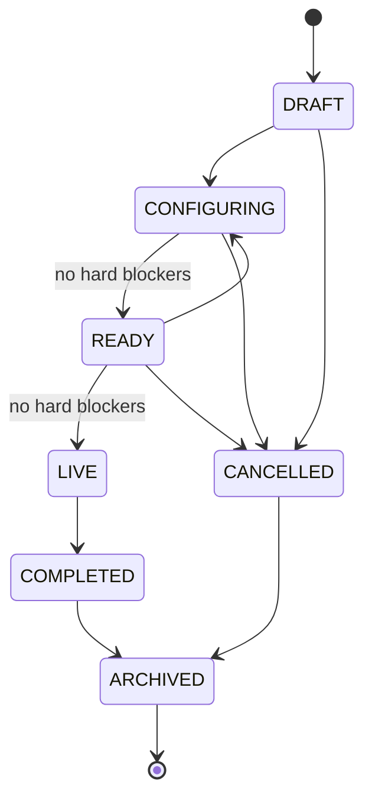
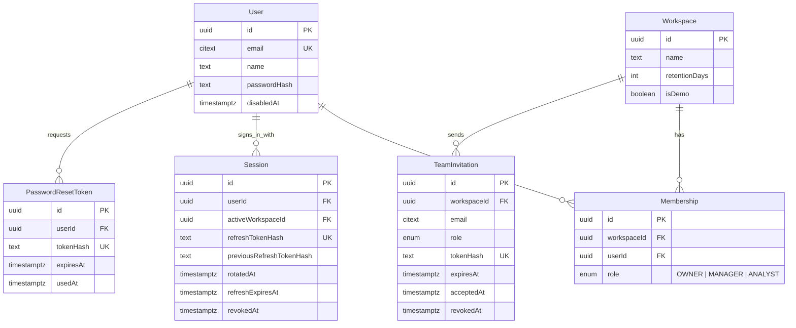
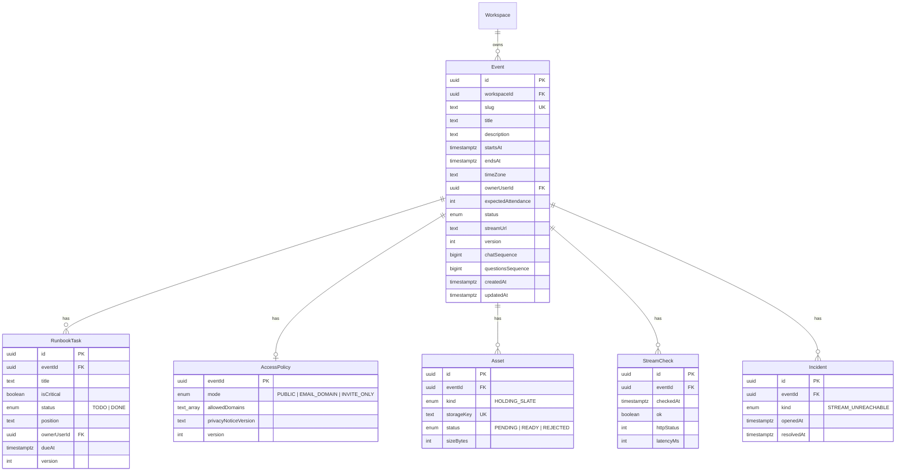
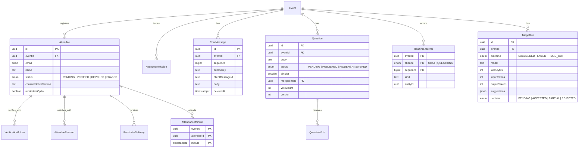
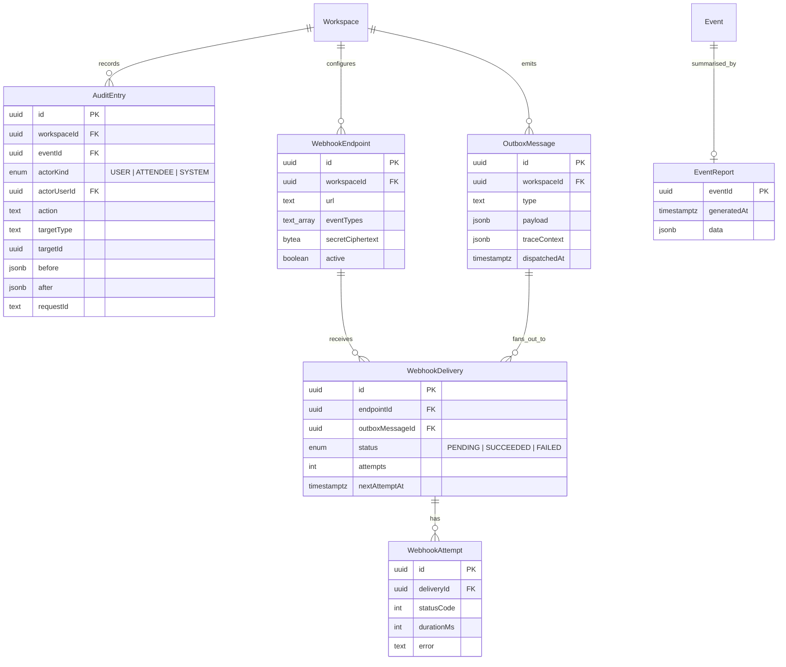

# 03 · Domain and data model

## 1. Bounded areas

| Area                 | Owns                                                                           | Key rules                                                                                |
| -------------------- | ------------------------------------------------------------------------------ | ---------------------------------------------------------------------------------------- |
| Identity and tenancy | users, workspaces, memberships, sessions, team invitations                     | Everything staff can see belongs to one workspace; roles are read fresh on every request |
| Event preparation    | events, runbook tasks, access policies, assets, stream checks, incidents       | The lifecycle state machine; hard blockers gate `READY` and `LIVE`                       |
| Audience             | attendees, invitations, verification, attendee sessions, reminders, attendance | Eligibility re-checked on every request; personal data has a retention limit             |
| Live interaction     | chat messages, questions, votes, real-time journals, triage runs               | No lost or duplicated messages; moderation is audited; AI only suggests                  |
| Record               | audit entries, outbox, webhooks, reports, idempotency records                  | Side effects happen exactly when the change commits                                      |

## 2. Event lifecycle

The transition table lives in `apps/api/src/events/domain/lifecycle.ts` as data, not as scattered `if` statements. A transition is applied inside one transaction:

1. lock the event row (`SELECT … FOR UPDATE`);
2. check the transition is allowed from the **current** status;
3. for `READY` and `LIVE`, evaluate readiness from the current data and reject if any hard blocker remains;
4. update the status and version, write the audit entry (including the readiness result) and the outbox message.

Because step 1 serialises concurrent requests for the same event, two simultaneous "go live" requests produce one success and one `409`.

## 3. Readiness rules

Readiness is a **pure function** of the event's current data: `assessReadiness(input, ruleVersion) → { score, criteria[], blockers[], nextActions[] }`. It has no database or clock access; the caller passes everything in, including "now".

| Criterion                                                  | Max points | Hard blocker when        |
| ---------------------------------------------------------- | ---------- | ------------------------ |
| Access policy configured                                   | 20         | missing                  |
| Stream reachable (latest check succeeded within 5 minutes) | 25         | failing or never checked |
| Critical runbook tasks done                                | 25         | any critical task open   |
| Holding slate uploaded                                     | 10         | missing                  |
| All runbook tasks done                                     | 10         | —                        |
| Owner assigned and description written                     | 10         | —                        |

Rule changes create a new rule version; tests pin each version's behaviour.

## 4. Entity relationship diagrams

### 4.1 Identity and tenancy

### 4.2 Event preparation

### 4.3 Audience and live interaction

### 4.4 Record

`IdempotencyRecord (scope, key, requestHash, responseStatus, responseBody, expiresAt)` stores responses to retried requests for 24 hours. The primary key is `(scope, key)`; the scope names the workspace, the user and the operation (`<workspaceId>:<userId>:create-event`), so a key never replays another user's response. Requests with the same key are serialised by a transaction-scoped advisory lock on the scope and key, and the record is written in the same transaction as the create.

## 5. Invariants and where they are enforced

The rule of thumb: **if a rule must hold under concurrency, the database enforces it**; the application also checks it first so users get a clear error.

| Invariant                                                    | Enforcement                                                                                                                                                                        |
| ------------------------------------------------------------ | ---------------------------------------------------------------------------------------------------------------------------------------------------------------------------------- |
| A user is a member of a workspace at most once               | Unique `(workspaceId, userId)`                                                                                                                                                     |
| A workspace always has at least one Owner                    | Checked in the transaction that changes roles, with the workspace's memberships locked                                                                                             |
| Only the newest invitation link for an address works         | Partial unique index `(workspaceId, email) WHERE acceptedAt IS NULL AND revokedAt IS NULL`; creates for one address are serialised by an advisory lock and revoke the previous one |
| No session survives a password reset                         | Sign-in re-reads the password hash `FOR SHARE` in the transaction that creates the session; the reset updates the user row, then revokes sessions, in one transaction              |
| An event ends after it starts                                | Check constraint `ends_at > starts_at`; the API checks the merged values first to name the field                                                                                   |
| A retried create never creates twice                         | Primary key `(scope, key)` on `IdempotencyRecord`, written in the create's transaction under an advisory lock on the key                                                           |
| An event cannot reach `READY` or `LIVE` with a hard blocker  | Event row locked, readiness re-evaluated inside the transaction                                                                                                                    |
| Edits based on stale data are rejected                       | `version` compared in the `UPDATE … WHERE id = $1 AND version = $2`; zero rows updated → `412`                                                                                     |
| At most 3 pinned questions per event                         | `pinSlot` in 1–3 (check constraint) + partial unique index `(eventId, pinSlot) WHERE pinSlot IS NOT NULL`                                                                          |
| One vote per attendee per question                           | Primary key `(questionId, attendeeId)`                                                                                                                                             |
| A retried chat send never duplicates                         | Unique `(eventId, authorKey, clientMessageId)`                                                                                                                                     |
| Real-time sequences have no gaps or duplicates               | Sequence allocated by `UPDATE event SET chatSequence = chatSequence + 1 … RETURNING` in the same transaction as the journal insert; primary key `(eventId, channel, sequence)`     |
| Each reminder is sent at most once                           | Unique `(attendeeId, kind)` on `ReminderDelivery`, inserted before sending                                                                                                         |
| A webhook is delivered at most once per endpoint per message | Unique `(endpointId, outboxMessageId)`                                                                                                                                             |
| Tokens are single-use                                        | Conditional `UPDATE … SET usedAt = now() WHERE tokenHash = $1 AND usedAt IS NULL AND expiresAt > now()`                                                                            |
| Staff data never crosses workspaces                          | Every query filters by `workspaceId`; cross-tenant tests per endpoint                                                                                                              |

## 6. Identifiers, time and money

- **IDs** are UUID v7 (time-ordered, good index locality), generated by the database with PostgreSQL 18's built-in `uuidv7()`.
- **Public URLs** use the event `slug` (readable title plus random suffix); internal IDs never appear in public pages.
- **Time** is stored as `timestamptz` in UTC. Each event stores an IANA time zone for display. The server never uses the host's local time zone.
- **Email addresses** use the `citext` type, so uniqueness ignores case.
- **AI cost** is stored as an integer number of micro-dollars, never as a floating-point value.

## 7. Indexes

Every foreign key is indexed. Additional indexes follow the main queries:

| Query                                  | Index                                                                     |
| -------------------------------------- | ------------------------------------------------------------------------- |
| Event list per workspace by start time | `(workspaceId, startsAt DESC, id DESC)`                                   |
| Event search by title                  | trigram index on `title` (`pg_trgm`)                                      |
| Real-time catch-up                     | primary key `(eventId, channel, sequence)`                                |
| Published questions by votes           | `(eventId, status, voteCount DESC)`                                       |
| Audit search                           | `(workspaceId, createdAt DESC)`, `(workspaceId, eventId, createdAt DESC)` |
| Outbox relay                           | partial index `(createdAt) WHERE dispatchedAt IS NULL`                    |
| Webhook retries                        | partial index `(nextAttemptAt) WHERE status = 'PENDING'`                  |

## 8. Data retention

| Data                          | Kept for                                                          | Then                                                                                                             |
| ----------------------------- | ----------------------------------------------------------------- | ---------------------------------------------------------------------------------------------------------------- |
| Attendee name and email       | Workspace retention period after the event ends (default 90 days) | Anonymised: name becomes "Former attendee", email replaced by a non-reversible hash, sessions and tokens deleted |
| Attendee erased on request    | —                                                                 | Anonymised immediately, the same way                                                                             |
| Verification and reset tokens | Until used or expired                                             | Deleted by the daily retention job                                                                               |
| Stream checks                 | 30 days                                                           | Deleted                                                                                                          |
| Attendance minutes            | Until the report is generated, plus 30 days                       | Deleted; the report keeps aggregates only                                                                        |
| Chat messages and questions   | Lifetime of the event                                             | Deleted with the event; authorship anonymised with the attendee                                                  |
| Audit entries                 | 2 years                                                           | Deleted                                                                                                          |
| Idempotency records           | 24 hours                                                          | Deleted                                                                                                          |
| Webhook delivery attempts     | 30 days                                                           | Deleted                                                                                                          |

The daily retention job is idempotent and audited as `SYSTEM`.
