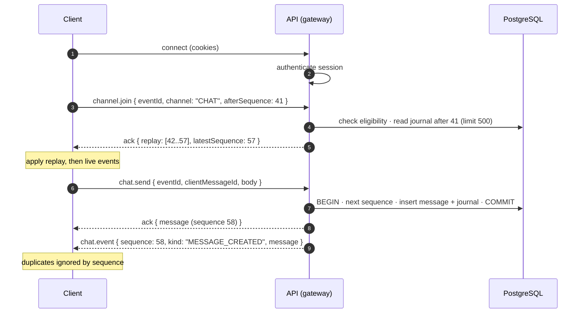

# 04 · API and contracts

## 1. Principles

- **One source of truth.** Every request, response, real-time message and webhook payload is a Zod schema in `packages/contracts`. The API validates with it, the web app types and validates forms with it, and the OpenAPI document is generated from it.
- **Resource-oriented REST** for reads and writes; **Socket.IO** for two-way live interaction; **server-sent events** for one-way live dashboards; **webhooks** for other systems.
- **Safe by default.** Retries never duplicate, stale writes never overwrite, and errors never leak internals.

## 2. HTTP conventions

| Topic          | Convention                                                                                                                                                                                                                              |
| -------------- | --------------------------------------------------------------------------------------------------------------------------------------------------------------------------------------------------------------------------------------- |
| Base path      | `/api/v1`. Additive changes stay in `v1`; breaking changes need `v2`.                                                                                                                                                                   |
| Format         | JSON in and out (`application/json`), field names in `camelCase`, enum values in `UPPER_SNAKE_CASE`.                                                                                                                                    |
| Time           | ISO 8601 in UTC with `Z`, e.g. `2026-11-20T18:30:00Z`.                                                                                                                                                                                  |
| IDs            | UUID strings. Public pages use the event `slug` instead.                                                                                                                                                                                |
| Authentication | Cookies only (`HttpOnly`). No tokens in URLs or local storage.                                                                                                                                                                          |
| CSRF           | State-changing requests must send an `Origin` header equal to the application origin.                                                                                                                                                   |
| Workspace      | Workspace routes act on the session's active workspace. Clients send `X-Workspace-Id` with the workspace they are showing; if the session has switched since, the API answers `409 WORKSPACE_CHANGED`.                                  |
| Pagination     | Cursor-based: `?limit=25&cursor=…` → `{ "items": [...], "nextCursor": "…"                                                                                                                                                               | null }`. `limit` defaults to 25, maximum 100. Cursors are opaque. |
| Concurrency    | Reads of editable resources return `ETag: "<version>"`. Updates require `If-Match`; a missing header (or `*`, which would match any version) returns `428`, a stale one `412`. A weak tag or a list never matches, so it is also `412`. |
| Idempotency    | Creates that clients may retry accept an `Idempotency-Key` header (UUID). The same key with the same body returns the original response; with a different body, `422`. Keys expire after 24 hours and belong to one user.               |
| Rate limits    | `429` with `Retry-After`. Limits per route are listed in the endpoint catalogue.                                                                                                                                                        |
| Caching        | Authenticated responses send `Cache-Control: no-store`.                                                                                                                                                                                 |

### 2.1 Status codes

| Code                  | Meaning in OpsPilot                                                                                  |
| --------------------- | ---------------------------------------------------------------------------------------------------- |
| `200` / `201` / `204` | Success; `201` for creates with a `Location` header                                                  |
| `400`                 | The request does not match its schema (field errors in `errors[]`)                                   |
| `401`                 | No valid session                                                                                     |
| `403`                 | Signed in, but the role does not allow this action                                                   |
| `404`                 | Not found — **also returned for resources in another workspace**, so their existence is not revealed |
| `409`                 | The action conflicts with the resource's state (illegal transition, hard blockers, archived event)   |
| `412`                 | `If-Match` does not match the current version                                                        |
| `413`                 | The request body is larger than 100 KB                                                               |
| `415`                 | The request body uses a non-UTF character set or an unsupported `Content-Encoding`                   |
| `422`                 | Idempotency key reused with a different request body                                                 |
| `428`                 | `If-Match` required but missing                                                                      |
| `429`                 | Rate limit exceeded                                                                                  |
| `500`                 | Unexpected error; the response contains only the request ID                                          |

### 2.2 Error format

All errors use `application/problem+json` ([RFC 9457](https://www.rfc-editor.org/rfc/rfc9457)) with a stable `code`:

```json
{
  "type": "/problems/event-has-blockers",
  "title": "The event has unresolved hard blockers",
  "status": 409,
  "code": "EVENT_HAS_BLOCKERS",
  "detail": "Resolve the blockers before moving the event to LIVE.",
  "blockers": [
    {
      "criterion": "STREAM_REACHABLE",
      "evidence": "Last check failed 2 minutes ago (HTTP 404)."
    }
  ],
  "requestId": "3c6d90b0-27df-40a7-bdac-23533c61a1f5"
}
```

Validation errors add `errors: [{ "path": "endsAt", "code": "too_small", "message": "End must be after start." }]`.

Error codes are defined once in `packages/contracts/src/errors.ts`; clients switch on `code`, never on `title` or `detail`.

## 3. Endpoint catalogue

`Role` column: **O** Owner, **M** Manager, **A** Analyst, **Att** attendee session, **Pub** no session. Owners can do everything Managers can.

### 3.1 Health and session

| Method and path                     | Role                 | Notes                                                                                                                                                                                                                                                             |
| ----------------------------------- | -------------------- | ----------------------------------------------------------------------------------------------------------------------------------------------------------------------------------------------------------------------------------------------------------------- |
| `GET /health/live`                  | Pub                  | Process is running                                                                                                                                                                                                                                                |
| `GET /health/ready`                 | Pub                  | Database and Valkey reachable; `503` otherwise. Health responses use their own body (`HealthReport`), not problem details, because load balancers and uptime checks read them                                                                                     |
| `POST /auth/sign-up`                | Pub                  | Creates user, workspace, Owner membership. Always `202` with the same body; an already registered email only gets an email. Rate-limited.                                                                                                                         |
| `POST /auth/sign-in`                | Pub                  | `204`; sets the session cookies. Wrong password, unknown email and disabled account fail identically (`CREDENTIALS_INVALID`). 10 failures / 15 min per account and per IP; every attempt reserves a slot before the password is checked and a success returns it. |
| `POST /auth/refresh`                | Pub (refresh cookie) | `204`; rotates the refresh token. The previous token within 10 s of its rotation: `204` with no `Set-Cookie`, leaving the cookies the concurrent request set. Later reuse revokes the session.                                                                    |
| `POST /auth/sign-out`               | Pub (refresh cookie) | `204`; revokes the session named by the refresh cookie (works with an expired access token) and clears the cookies                                                                                                                                                |
| `POST /auth/password-reset/request` | Pub                  | Always `202` with the same body; at most 3 emails per account and 10 requests per address an hour                                                                                                                                                                 |
| `POST /auth/password-reset/confirm` | Pub                  | Token + new password; the link works once within 30 minutes; signs the user out everywhere                                                                                                                                                                        |
| `POST /auth/demo`                   | Pub                  | Demo mode only                                                                                                                                                                                                                                                    |
| `GET /me`                           | O M A                | User, memberships, active workspace and role                                                                                                                                                                                                                      |
| `PUT /me/active-workspace`          | O M A                | Switches the session's workspace; one the user does not belong to is `404`                                                                                                                                                                                        |

### 3.2 Workspace and team

A membership, invitation or workspace outside the session's active workspace is always `404`, never `403`, so other workspaces' data cannot even be confirmed to exist. Links in emails carry their token in the URL fragment (`#token=…`), which browsers never send to a server, and the web app posts it in a request body.

| Method and path                                              | Role            | Notes                                                                                                          |
| ------------------------------------------------------------ | --------------- | -------------------------------------------------------------------------------------------------------------- |
| `GET /workspace` · `PATCH /workspace`                        | O (read: O M A) | Name, retention period                                                                                         |
| `GET /workspace/members`                                     | O M A           |                                                                                                                |
| `PATCH /workspace/members/:membershipId`                     | O               | Role change; last Owner protected                                                                              |
| `DELETE /workspace/members/:membershipId`                    | O               | Revokes the member's sessions in this workspace; last Owner protected                                          |
| `POST /workspace/members/:membershipId/sign-out`             | O               | Signs the member out everywhere (FR-AUTH-3)                                                                    |
| `GET /workspace/invitations` · `POST /workspace/invitations` | O               | Invite by email and role; revokes the address's previous unanswered invitation, so only the newest link works  |
| `DELETE /workspace/invitations/:id`                          | O               | Revoke                                                                                                         |
| `POST /team-invitations/preview`                             | Pub             | Token in the body; workspace, email, role and whether an account exists                                        |
| `POST /team-invitations/accept`                              | Pub             | Token in the body; creates the user (name and password required) or links an existing one, then the membership |

### 3.3 Events and Launch Control

| Method and path                            | Role      | Notes                                                                                                                                                 |
| ------------------------------------------ | --------- | ----------------------------------------------------------------------------------------------------------------------------------------------------- |
| `GET /events`                              | O M A     | `q` (title, case-insensitive), `status` (repeatable), `from` ≤ start < `to`, cursor; latest start first                                               |
| `POST /events`                             | M         | `Idempotency-Key`                                                                                                                                     |
| `GET /events/:id`                          | O M A     | `ETag`                                                                                                                                                |
| `PATCH /events/:id`                        | M         | `If-Match`; `409 EVENT_ARCHIVED` once archived                                                                                                        |
| `POST /events/:id/transitions`             | M         | Body `{ "to": "READY" }`; `200` with the event; `409 EVENT_HAS_BLOCKERS` (with `blockers`) or `409 ILLEGAL_TRANSITION` (with `from`, `to`, `allowed`) |
| `GET /events/:id/readiness`                | O M A     | Score, criteria with evidence, blockers, next actions, rule version                                                                                   |
| `GET /events/:id/runbook-tasks` · `POST …` | O M A · M |                                                                                                                                                       |
| `PATCH /runbook-tasks/:id` · `DELETE …`    | M         | `If-Match`; `status: "DONE"` completes (records who and when), `"TODO"` reopens                                                                       |
| `POST /runbook-tasks/:id/move`             | M         | `{ "after": "<taskId>" or null }`; returns the whole runbook in its new order                                                                         |
| `GET /events/:id/access-policy` · `PUT …`  | O M A · M | `404` until set. The first `PUT` creates it and must not send `If-Match`; later ones must                                                             |
| `PUT /events/:id/stream`                   | M         | `{ "url": "https://…/index.m3u8" }`; the host must resolve only to public addresses (SSRF); returns the event and queues a check at once              |
| `GET /events/:id/stream/checks` · `POST …` | O M A · M | Most recent first, cursor; `POST` asks for a check now: `202`, at most 6 a minute per event, `409 STREAM_NOT_SET` without a URL                       |
| `GET /events/:id/incidents`                | O M A     | Every incident, most recently opened first (not paginated: at most a handful per event)                                                               |
| `POST /events/:id/assets/holding-slate`    | M         | Returns a presigned upload URL and the asset ID                                                                                                       |
| `POST /assets/:id/complete`                | M         | Verifies type and size in storage, marks the asset `READY`                                                                                            |

### 3.4 Audience (staff side)

| Method and path                                 | Role  | Notes                                                 |
| ----------------------------------------------- | ----- | ----------------------------------------------------- |
| `GET /events/:id/attendees`                     | O M A | Status filter, cursor; email shown masked to Analysts |
| `POST /events/:id/attendees/:attendeeId/revoke` | M     | Ends live sessions within 5 seconds                   |
| `POST /events/:id/attendees/:attendeeId/erase`  | M     | UK GDPR erasure; audited                              |
| `GET /events/:id/invitations` · `POST …`        | M     | Invitation-only events                                |
| `DELETE /event-invitations/:id`                 | M     | Also revokes the attendee if registered               |

### 3.5 Public and attendee

| Method and path                           | Role | Notes                                                                  |
| ----------------------------------------- | ---- | ---------------------------------------------------------------------- |
| `GET /public/events/:slug`                | Pub  | Data for the public page; no internal IDs                              |
| `POST /public/events/:slug/registrations` | Pub  | Always `202` with the same body (no enumeration). Rate-limited per IP. |
| `POST /public/attendee-verifications`     | Pub  | `{ "token": "…" }`; sets the attendee session cookie                   |
| `GET /public/events/:slug/me`             | Att  | The attendee's own registration and access state                       |
| `POST /public/events/:slug/heartbeat`     | Att  | Every 30 s while watching; records attendance                          |
| `POST /public/reminders/unsubscribe`      | Pub  | Token from the reminder email                                          |

### 3.6 Live interaction

Both staff and attendee sessions are accepted; permissions differ by role.

| Method and path                           | Role      | Notes                                                        |
| ----------------------------------------- | --------- | ------------------------------------------------------------ |
| `GET /events/:id/chat/messages`           | O M A Att | History; `before=<sequence>` for older pages                 |
| `GET /events/:id/questions`               | O M A Att | Attendees see published questions and their own pending ones |
| `POST /events/:id/questions`              | Att M     | `Idempotency-Key`; rate-limited                              |
| `PUT /questions/:id/vote` · `DELETE …`    | Att       | Idempotent by design                                         |
| `PATCH /questions/:id`                    | M         | Status, pin slot, answered; `If-Match`                       |
| `POST /events/:id/question-triage-runs`   | M         | Starts a triage run; returns `202` and the run ID            |
| `GET /question-triage-runs/:id`           | M         | Suggestions or the failure reason                            |
| `POST /question-triage-runs/:id/decision` | M         | Which groups to merge; applied in one transaction            |
| `GET /events/:id/live-ops`                | O M A     | Snapshot for the operations room                             |
| `GET /events/:id/live-ops/stream`         | O M A     | Server-sent events (section 5)                               |

### 3.7 Record

| Method and path                             | Role  | Notes                                                |
| ------------------------------------------- | ----- | ---------------------------------------------------- |
| `GET /audit-entries`                        | O M A | `eventId`, `actorId`, `action`, `from`, `to`, cursor |
| `GET /webhook-endpoints` · `POST …`         | O     | Secret returned once on create                       |
| `PATCH /webhook-endpoints/:id` · `DELETE …` | O     |                                                      |
| `POST /webhook-endpoints/:id/rotate-secret` | O     | New secret returned once                             |
| `GET /webhook-deliveries`                   | O     | `endpointId`, `status`, cursor; includes attempts    |
| `POST /webhook-deliveries/:id/redeliver`    | O     | Creates a new attempt                                |
| `GET /events/:id/report`                    | O M A | Available once `COMPLETED`                           |
| `GET /events/:id/report.csv`                | O M A | `text/csv`                                           |

## 4. Real-time protocol (Socket.IO)

Namespace `/realtime`. The handshake is authenticated by the browser's cookies (staff or attendee session). Message names and payloads are Zod schemas in `packages/contracts/src/realtime.ts`.



| Direction       | Name              | Payload                               | Notes                                                                                                   |
| --------------- | ----------------- | ------------------------------------- | ------------------------------------------------------------------------------------------------------- |
| client → server | `channel.join`    | `{ eventId, channel, afterSequence }` | Ack returns the replay (at most 500) and the latest sequence, or `RESYNC_REQUIRED` if the gap is larger |
| client → server | `channel.leave`   | `{ eventId, channel }`                |                                                                                                         |
| client → server | `chat.send`       | `{ eventId, clientMessageId, body }`  | Ack returns the stored message; retrying with the same `clientMessageId` returns the same message       |
| server → client | `chat.event`      | `{ sequence, kind, message }`         | `kind`: `MESSAGE_CREATED`, `MESSAGE_DELETED`                                                            |
| server → client | `questions.event` | `{ sequence, kind, question }`        | `kind`: `CREATED`, `UPDATED`, `VOTED`, `MERGED`                                                         |
| server → client | `event.status`    | `{ eventId, status }`                 | Switches the watch page from holding slate to stream                                                    |
| server → client | `session.revoked` | `{ reason }`                          | Sent before the server disconnects a revoked client                                                     |

**Client rules.** Keep the highest applied sequence per channel; ignore events at or below it; on reconnect join with `afterSequence` = that value; on `RESYNC_REQUIRED`, reload the snapshot over HTTP and continue from its sequence. Reconnect with exponential backoff and jitter (1 s doubling to 30 s).

## 5. Server-sent events (operations room)

`GET /api/v1/events/:id/live-ops/stream`, `Content-Type: text/event-stream`.

| `event:`                                | `data:`                                     | When                    |
| --------------------------------------- | ------------------------------------------- | ----------------------- |
| `snapshot`                              | Full operations-room state                  | On connect              |
| `stream.status`                         | `{ ok, checkedAt, latencyMs }`              | After each stream check |
| `audience.updated`                      | `{ current, peak }`                         | Every 30 s              |
| `rates.updated`                         | `{ messagesPerMinute, questionsPerMinute }` | Every 30 s              |
| `incident.opened` · `incident.resolved` | The incident                                | On change               |

Each message has an increasing `id:`. On reconnect the browser sends `Last-Event-ID`; the server sends a fresh `snapshot` if it cannot replay. A comment line is sent every 15 seconds to keep proxies from closing idle connections.

## 6. Webhooks

### 6.1 Delivery

```http
POST /customer/receiver HTTP/1.1
Content-Type: application/json
OpsPilot-Event-Id: 0193f2a4-7c1e-7b2a-9d1f-3e5c7a9b1d2f
OpsPilot-Event-Type: event.live
OpsPilot-Signature: t=1795000000,v1=5f2c…

{
  "id": "0193f2a4-7c1e-7b2a-9d1f-3e5c7a9b1d2f",
  "type": "event.live",
  "occurredAt": "2026-11-20T18:30:02Z",
  "workspaceId": "…",
  "data": { "eventId": "…", "title": "Product launch", "startsAt": "2026-11-20T18:30:00Z" }
}
```

- **Signature**: `v1` = hex HMAC-SHA256 of `"<t>.<raw body>"` with the endpoint's secret. Receivers should reject timestamps older than 5 minutes.
- **Success** = any `2xx` within 10 seconds. Anything else, or a timeout, is a failure.
- **Retries**: up to 5 attempts in total, at about 1 minute, 5 minutes, 30 minutes and 2 hours after the first, with jitter. Then the delivery is `FAILED` and can be resent manually.
- **Ordering** is not guaranteed; receivers de-duplicate by `id`.
- **Targets** must be `https` and resolve to public addresses (SSRF protection).

### 6.2 Event types

| Type                  | When                                                                                       |
| --------------------- | ------------------------------------------------------------------------------------------ |
| `event.ready`         | Event reached `READY`                                                                      |
| `event.live`          | Event reached `LIVE`                                                                       |
| `event.completed`     | Event reached `COMPLETED`                                                                  |
| `event.cancelled`     | Event was cancelled                                                                        |
| `attendee.registered` | An attendee verified their email (personal data included only if the workspace enables it) |

## 7. OpenAPI document

`npm run contracts:openapi` builds an OpenAPI 3.1 document from the route registry in `packages/contracts` (each route declares its method, path, roles and Zod schemas). CI fails if the committed document is out of date, so API changes are visible in pull-request diffs. Swagger UI serves it at `/api/docs` in non-production environments.
