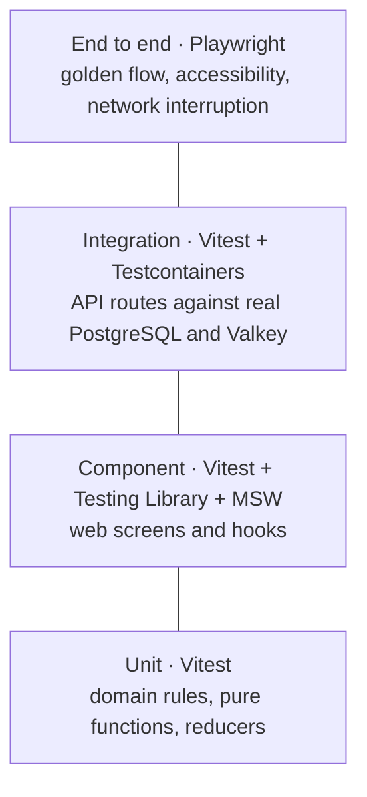

# 05 · Engineering standards

These standards apply to every pull request. CI enforces what a machine can check; reviewers check the rest against the checklists at the end.

## 1. TypeScript

- `strict: true`, plus `noUncheckedIndexedAccess`, `noImplicitOverride` and `verbatimModuleSyntax` (ES modules everywhere).
- No `any`. Use `unknown` at boundaries and narrow it with a Zod schema or a type guard.
- No non-null assertions (`!`) outside tests.
- Model alternatives as **discriminated unions** and handle them with exhaustive `switch` statements:

  ```ts
  function label(status: EventStatus): string {
    switch (status) {
      case "DRAFT":
        return "Draft";
      // … every other case …
      default:
        return status satisfies never;
    }
  }
  ```

- Types for data that crosses a boundary (HTTP, real-time, jobs, webhooks) are **inferred from Zod schemas** in `packages/contracts`, never written twice.
- Prefer plain functions and objects. Classes are for NestJS providers and controllers, where the framework needs them.

## 2. Formatting and linting

- **Prettier** with default settings formats everything; CI runs `prettier --check`.
- **ESLint** with `typescript-eslint` type-checked rules. Rules that matter most here:
  - `@typescript-eslint/no-floating-promises` and `no-misused-promises` — every promise is awaited or explicitly handled;
  - `@typescript-eslint/consistent-type-imports`;
  - `one-var: never` and `no-nested-ternary` — readability over brevity;
  - `eqeqeq`, `no-console` (use the logger).
- **dependency-cruiser** enforces architecture rules in CI:
  - `domain/` folders import nothing from NestJS, Prisma or Node I/O modules;
  - a feature module never imports another feature's internals, only its public `index.ts`;
  - `apps/web` never imports from `apps/api`; both may import `packages/contracts`.

## 3. Naming and files

| Thing                   | Convention                                                                               | Example                                                                                |
| ----------------------- | ---------------------------------------------------------------------------------------- | -------------------------------------------------------------------------------------- |
| Files and folders       | `kebab-case`                                                                             | `launch-control.service.ts`                                                            |
| React components        | `PascalCase`, one exported component per file                                            | `ReadinessPanel` in `readiness-panel.tsx`                                              |
| Hooks                   | `useSomething`                                                                           | `useChatChannel`                                                                       |
| Functions and variables | `camelCase`, verbs for functions                                                         | `assessReadiness`, `nextSequence`                                                      |
| Types and schemas       | `PascalCase`; schema and type share a name                                               | `const EventSummary = z.object(…)`; `type EventSummary = z.infer<typeof EventSummary>` |
| Constants               | `UPPER_SNAKE_CASE` only for true constants                                               | `MAX_PINNED_QUESTIONS`                                                                 |
| Error codes             | `UPPER_SNAKE_CASE`, noun first                                                           | `EVENT_HAS_BLOCKERS`                                                                   |
| Tests                   | Next to the code: `*.test.ts`; integration: `*.int.test.ts`; end to end: `e2e/*.spec.ts` | `lifecycle.test.ts`                                                                    |

## 4. Writing code that teaches well

This codebase is also teaching material, so clarity beats cleverness:

- **One idea per function.** If a function needs a comment to separate its parts, split it into named functions.
- **Comments explain why**, not what: the race a lock prevents, the attack a check stops, the reason for a number. A comment that restates the code is deleted in review.
- **No magic values.** Durations, limits and thresholds are named constants next to the code that uses them, with units in the name (`ACCESS_TOKEN_TTL_SECONDS`).
- **Early returns** instead of deep nesting.
- **Exported functions in `domain/` and `packages/contracts` have TSDoc** describing inputs, outputs and the rules they implement.
- **Files stay small.** Around 300 lines is a signal to split; a React component that mixes data fetching, state and layout is split into a container and presentational parts.

## 5. Errors and logging

- Business rule violations throw a `DomainError` with a code from `packages/contracts`. One exception filter maps errors to problem responses; controllers never build error responses themselves.
- Never swallow an error. If an error is handled, the handler either recovers meaningfully or logs it with context and rethrows.
- Log with the injected pino logger, never `console`. Levels: `error` (needs attention), `warn` (unexpected but handled), `info` (business events, one per request at most), `debug` (local only).
- **Never log** passwords, tokens, cookies, secrets, full request bodies or attendee email addresses. Redaction paths are configured centrally and tested.

## 6. Testing strategy



| Level             | What it proves                                                                           | Rules                                                                                                                                                                                                                                                     |
| ----------------- | ---------------------------------------------------------------------------------------- | --------------------------------------------------------------------------------------------------------------------------------------------------------------------------------------------------------------------------------------------------------- |
| **Unit**          | Domain rules are correct for every case                                                  | Pure functions only; no mocks needed. Readiness rules, lifecycle, eligibility, real-time client reducers.                                                                                                                                                 |
| **Component**     | Screens behave correctly for users                                                       | Query by role and label, as a user would. MSW for HTTP. Every screen tested in loading, empty, error and success states.                                                                                                                                  |
| **Integration**   | Endpoints enforce authentication, authorisation, validation, concurrency and persistence | Real PostgreSQL and Valkey in containers (Testcontainers). Each test file gets a fresh schema. Includes cross-workspace access tests and race tests for every invariant in [03 §5](03-domain-and-data-model.md#5-invariants-and-where-they-are-enforced). |
| **End to end**    | The golden flow works in a browser                                                       | Runs against production builds. Includes axe checks on every page and chat recovery after a forced disconnect.                                                                                                                                            |
| **Contract**      | Clients and server agree                                                                 | The generated OpenAPI document must match the committed one.                                                                                                                                                                                              |
| **AI evaluation** | Triage suggestions are useful and safe                                                   | Fixed question sets with expected groupings; scored in CI against recorded model responses, and against the live model before each release.                                                                                                               |
| **Load**          | NFR-4 capacity                                                                           | k6 scenario: 500 viewers, 20 messages per second, run before public releases.                                                                                                                                                                             |

Further rules:

- **Time and randomness are injected.** Code takes a `Clock` and ID generator from dependency injection, so tests are deterministic.
- **Test data comes from builders** (`anEvent().live().build()`), never from shared mutable fixtures.
- **Coverage**: `domain/` folders must keep at least 90% line and branch coverage (CI-gated). Elsewhere coverage is reported, not gated; meaningful assertions matter more than percentages.
- **Flaky tests** are fixed or quarantined with an issue the same day; they are never retried until green.

## 7. Security checklist (every pull request)

- [ ] All new input is validated with a contracts schema.
- [ ] New endpoints declare their roles, and queries are scoped by `workspaceId`.
- [ ] A cross-workspace test exists for each new endpoint.
- [ ] No secrets, tokens or personal data in code, logs, errors or test snapshots.
- [ ] Outbound requests to user-supplied URLs go through the SSRF-safe client.
- [ ] New dependencies are maintained, permissively licensed and justified in the pull request.

## 8. Accessibility

- Target: **WCAG 2.2 level AA**.
- Semantic HTML first; ARIA only where HTML has no equivalent. shadcn/ui primitives provide keyboard behaviour; do not override it.
- Every interactive element is reachable and operable by keyboard with a visible focus indicator.
- Dialogs trap focus and return it to the trigger on close.
- Real-time updates are announced politely (`aria-live="polite"` for new chat messages and questions; `assertive` only for incidents in the operations room).
- Colour is never the only signal; text contrast is at least 4.5:1, enforced by the design tokens.
- Charts have a text summary and an accessible data table alternative.

## 9. Performance budgets

| Metric                                            | Budget              |
| ------------------------------------------------- | ------------------- |
| Public event page, Largest Contentful Paint (p75) | < 2.5 s             |
| Interaction to Next Paint (p75)                   | < 200 ms            |
| Cumulative Layout Shift (p75)                     | < 0.1               |
| JavaScript on the public event page               | ≤ 150 kB compressed |
| API read endpoints (p95 at target load)           | < 300 ms            |

How they are checked, in CI's images job on every pull request (`npm run lighthouse`, on the seeded demo event's public page in the production-like stack, as a mid-range phone on slow 4G with the CPU slowed four times):

- **Lighthouse CI** (`lighthouserc.cjs`, median of three runs): Largest Contentful Paint, Cumulative Layout Shift, the JavaScript budget, and an accessibility score of at least 0.95. These are lab figures; the targets above are for field data at the 75th percentile, which the lab must beat.
- **Interaction to Next Paint** (`scripts/lighthouse-inp.mjs`): a Lighthouse user flow fills in and submits the registration form; the median of five runs must stay under 200 ms. A page load has no interactions, so Lighthouse's usual stand-in, Total Blocking Time, is only reported: React and the Next.js runtime alone take about 200 ms of it on this emulated phone, measured on a public page without the form, so it says little about the page's own work.

To stay within the JavaScript budget, the public event page loads no Zod, no form library, no Radix and no Tailwind class-merging engine (its controls are in `src/features/public/public-ui.tsx`), and the browser loads the Sentry SDK only when the first error happens.

**Accessibility.** Every page is checked with axe against WCAG 2.2 AA in the browser tests (`e2e/accessibility.spec.ts`), with and without a session; a violation fails CI. Beyond what axe can judge: the golden flow is walked by keyboard alone, every tab stop checked for a visible focus indicator (`e2e/keyboard.spec.ts`); pages are checked at 320 CSS pixels for reflow and target size (`e2e/layout.spec.ts`); and the design tokens' contrast is computed (`apps/web/src/app/tokens.test.ts`). The audit, criterion by criterion, is [docs/accessibility-audit.md](accessibility-audit.md).

## 10. Git workflow

- **Trunk-based**: `main` is always releasable and protected (pull request required, CI must pass, linear history).
- **Short-lived branches** named `<type>/<short-description>` (`feat/question-triage`, `fix/refresh-token-race`).
- **Conventional Commits** for pull-request titles; pull requests are **squash-merged**, so the title becomes the commit message on `main`.
- **Small pull requests**: one concern each, ideally under 400 changed lines excluding generated files.
- Every pull request description says **what** changed, **why**, and **how it was tested**, and links the requirement IDs it implements.

## 11. Dependencies

- Versions are locked by `package-lock.json`; CI installs with `npm ci`.
- Install scripts of dependencies run only when `allowScripts` in the root `package.json` approves them (npm 12 blocks the rest). Only Prisma's are approved, pinned to the reviewed version, because they fetch the migration engine; the others are denied, because each has a prebuilt or pure-JavaScript fallback. An update to an approved package needs a new approval (`npm install-scripts approve <package>`) after reviewing its scripts.
- Dependabot opens weekly grouped updates; major upgrades get their own pull request and, if they change behaviour, an ADR.
- `npm audit --omit=dev` must report no high or critical vulnerabilities in production dependencies.
- Only permissive licences (MIT, Apache-2.0, BSD, ISC) in production dependencies.

## 12. Definition of done

A change is done when:

- [ ] acceptance criteria of the linked requirements are met and covered by tests at the right level;
- [ ] lint, format, type check, unit, integration and end-to-end tests pass in CI;
- [ ] the security and accessibility checklists are satisfied;
- [ ] logs, metrics or traces make the new behaviour observable in production;
- [ ] documentation and, where relevant, an ADR are updated in the same pull request;
- [ ] the change is deployed to the demo environment by the pipeline and smoke-tested.

## 13. Review checklist

Reviewers ask:

1. **Correctness** — does it meet the requirement, including failure and concurrency cases?
2. **Boundaries** — is each piece in the right layer and module?
3. **Clarity** — could a new team member understand it without the author? Are names and comments honest?
4. **Tests** — would the tests fail if the behaviour broke?
5. **Operations** — what happens when a dependency is slow or down, and how would we know?
