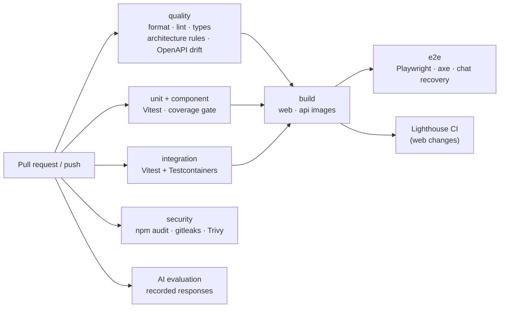
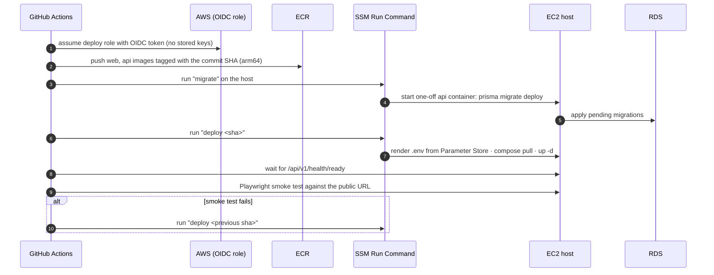

# 06 · Infrastructure and operations

## 1. Local development

### 1.1 Prerequisites

Node.js 26 (from `.nvmrc`), npm 11, Docker with Compose v2.

### 1.2 Services

`docker-compose.yml` runs the infrastructure; the applications run on the host with hot reload. A Caddy container gives the browser **one origin**, exactly as in production, so cookies, WebSockets and server-sent events behave the same locally.

| Service                          | Image                    | Port on your machine                | Purpose                                                                                                                                                                        |
| -------------------------------- | ------------------------ | ----------------------------------- | ------------------------------------------------------------------------------------------------------------------------------------------------------------------------------ |
| proxy                            | `caddy:2`                | **3300** (open this in the browser) | Routes `/api/*` and `/realtime` to the API, everything else to the web app                                                                                                     |
| web (host)                       | —                        | 3301                                | `next dev`                                                                                                                                                                     |
| api (host)                       | —                        | 4301                                | NestJS API                                                                                                                                                                     |
| worker (host)                    | —                        | —                                   | NestJS worker                                                                                                                                                                  |
| postgres                         | `postgres:18-alpine`     | 5443                                | Database (`opspilot`; tests use their own containers). PostgreSQL 18 images keep data under `/var/lib/postgresql/18/docker`, so the volume is mounted at `/var/lib/postgresql` |
| valkey                           | `valkey/valkey:9-alpine` | 6392                                | Queues, rate limits, pub/sub                                                                                                                                                   |
| s3                               | `chrislusf/seaweedfs`    | 8333                                | S3-compatible object storage                                                                                                                                                   |
| mailpit                          | `axllent/mailpit`        | 1036 (SMTP), 8036 (inbox UI)        | Captures every email sent locally                                                                                                                                              |
| otel _(profile `observability`)_ | `grafana/otel-lgtm`      | 3310 (Grafana)                      | Local traces, logs and metrics                                                                                                                                                 |

Ports are chosen so OpsPilot can run beside the course projects on the same machine. Every port is bound to `127.0.0.1` and can be overridden in `.env`. Images are pinned to exact versions in the compose file; the table shows only the series.

### 1.3 Everyday commands

| Command               | What it does                                                                             |
| --------------------- | ---------------------------------------------------------------------------------------- |
| `npm run services:up` | Start the services and wait until all health checks pass                                 |
| `npm run db:migrate`  | Apply migrations to the development database                                             |
| `npm run db:seed`     | Load the demo workspace and sample events                                                |
| `npm run dev`         | Start web, api and worker with hot reload                                                |
| `npm test`            | Unit and component tests in every workspace                                              |
| `npm run test:int`    | API integration tests (starts its own containers)                                        |
| `npm run test:e2e`    | Production builds plus Playwright                                                        |
| `npm run check`       | Everything CI's quality job runs: format, lint, types, architecture rules, OpenAPI drift |

## 2. Environments

| Environment | Where                     | Data                                                     | Deployed by                        |
| ----------- | ------------------------- | -------------------------------------------------------- | ---------------------------------- |
| **Local**   | Developer machine         | Seeded, disposable                                       | `npm run dev`                      |
| **CI**      | GitHub Actions runners    | Created per job, destroyed after                         | Each pull request and push         |
| **Demo**    | AWS, London (`eu-west-2`) | Demo workspace reset nightly, plus real events run on it | Pipeline, on every merge to `main` |

There is deliberately one cloud environment. Pull requests are verified in CI against production builds; a staging environment would add cost without catching anything CI does not.

## 3. Continuous integration



- Jobs run in parallel where they do not depend on each other; `npm ci` uses the npm cache keyed by the lock file.
- The same container images built in `build` are used by `e2e` and, after merge, deployed. What was tested is what ships.
- `main` requires every job to pass.

## 4. Continuous delivery



- **Immutable images**: tagged with the commit SHA, never `latest`. Rollback means deploying the previous SHA.
- **Migrations before code**, using the expand-and-contract pattern: a migration must work with both the old and the new application version, so a rollback never needs a down-migration.
- **Manual approval** is required for the GitHub `demo` environment only when infrastructure changes are applied.

## 5. AWS infrastructure (Terraform)

```text
infra/terraform/
├── bootstrap/          state bucket, GitHub OIDC provider (applied once)
├── modules/
│   ├── network/        VPC, public subnet for the host, private subnets for RDS
│   ├── database/       RDS PostgreSQL 18, parameter group, backups
│   ├── compute/        EC2 host, instance profile, security group, user data
│   ├── storage/        S3 bucket for assets and exports
│   ├── email/          SES domain identity, DKIM, configuration set
│   ├── registry/       ECR repositories and lifecycle policies
│   ├── github-oidc/    deploy and plan roles trusted by this repository only
│   ├── dns/            Route 53 records
│   └── budgets/        AWS Budgets alerts
└── environments/demo/  wiring and variables for the demo environment
```

| Resource       | Configuration                                                                                                                                   | Why                                                                                 |
| -------------- | ----------------------------------------------------------------------------------------------------------------------------------------------- | ----------------------------------------------------------------------------------- |
| EC2 host       | ARM (Graviton), Amazon Linux 2023, Docker Compose; no SSH key — access through SSM Session Manager                                              | Lowest cost that meets NFR-4; no open SSH port                                      |
| RDS PostgreSQL | Single-AZ, encrypted, 7-day point-in-time recovery, private subnets only                                                                        | Managed backups and patching; the database is never reachable from the internet     |
| Valkey         | Container on the host                                                                                                                           | Holds only reconstructible data (queues, counters); ElastiCache is the upgrade path |
| S3             | Private, Block Public Access on, encryption, lifecycle rules for exports                                                                        | Holding slates are served through short-lived presigned URLs                        |
| SES            | Domain identity with DKIM and a configuration set for bounces                                                                                   | Deliverability and bounce handling                                                  |
| ECR            | Scan on push, keep the last 20 images                                                                                                           | Supply-chain visibility and cost control                                            |
| IAM            | Instance role: pull images, read parameters, use its own bucket, send email. Deploy role: push images, send SSM commands. Plan role: read-only. | Least privilege; GitHub OIDC trust limited to this repository and branch            |
| Budgets        | Alerts at 50%, 80% and 100% of the monthly budget                                                                                               | No surprises                                                                        |

Terraform state lives in an encrypted, versioned S3 bucket with S3-native state locking. Pull requests that touch `infra/` get a `terraform plan` comment; `apply` runs only after merge and approval.

The documented upgrade path when traffic grows: move web, api and worker to **ECS Fargate** behind an **Application Load Balancer**, and Valkey to **ElastiCache**. The application needs no code changes for this ([ADR-0010](adr/0010-aws-deployment.md)).

## 6. Configuration and secrets

- Each process validates its configuration at startup (Zod) and exits with a list of problems if anything is wrong.
- **Locally**: `.env` (git-ignored), created from `.env.example`.
- **On AWS**: secrets are `SecureString` parameters in Systems Manager Parameter Store, encrypted with KMS. The deploy command renders them into an env file readable only by the service user. Nothing secret is baked into images.
- **Rotation**: JWT signing keys support a current and a previous key so rotation does not sign everyone out; webhook secrets rotate per endpoint; database credentials rotate through RDS.

## 7. Observability

| Signal  | Tool                                                               | What we look at                                                                                                         |
| ------- | ------------------------------------------------------------------ | ----------------------------------------------------------------------------------------------------------------------- |
| Logs    | pino → OpenTelemetry Collector → Grafana Cloud                     | Errors by route, slow requests, job failures                                                                            |
| Traces  | OpenTelemetry SDK (web server, api, worker) → Grafana Cloud        | One request across services and jobs; slow database queries                                                             |
| Metrics | OpenTelemetry metrics                                              | Request rate, errors and duration per route; queue depth and job age; open real-time connections; stream-check failures |
| Errors  | Sentry (browser, web server, api, worker)                          | New and regressed errors per release                                                                                    |
| Uptime  | External check on `/api/v1/health/ready` and the public event page | Availability                                                                                                            |

**Service level objectives** for the demo environment:

| Objective                                     | Target             |
| --------------------------------------------- | ------------------ |
| Availability of the public event page and API | 99.5% per month    |
| Chat delivery latency                         | 95% under 1 second |
| Stream outage visible in the operations room  | Within 60 seconds  |

**Alerts** (email): 5xx rate above 2% for 5 minutes, readiness check failing for 2 minutes, oldest queued job older than 5 minutes, webhook deliveries failing for one endpoint more than 10 times in an hour.

## 8. Backups and recovery

| Item           | Approach                                                                                                               | Targets                                                                 |
| -------------- | ---------------------------------------------------------------------------------------------------------------------- | ----------------------------------------------------------------------- |
| Database       | RDS automated backups with point-in-time recovery; manual snapshot before each migration that changes or drops columns | Recovery point within 5 minutes; recovery time under 1 hour             |
| Object storage | S3 versioning on the asset bucket                                                                                      | Undo accidental deletes for 30 days                                     |
| Valkey         | Not backed up                                                                                                          | Queues are rebuilt from the outbox; counters and presence are ephemeral |
| Infrastructure | Terraform state, versioned                                                                                             | Rebuild from code                                                       |

Restores are rehearsed once before the public demo, following the runbook.

## 9. Runbooks

Each runbook lives in `docs/runbooks/` and follows the same shape: **symptoms → checks → actions → verification**.

| Runbook                                 | When                                    |
| --------------------------------------- | --------------------------------------- |
| Deploy and roll back                    | Every release; failed smoke test        |
| Restore the database to a point in time | Data loss or corruption                 |
| Rotate a secret                         | Suspected leak; scheduled rotation      |
| Webhook endpoint failing                | Delivery alert                          |
| Stream check reports false outages      | Incidents opened while the stream plays |
| Demo reset failed                       | Demo workspace not reset by 06:00       |

## 10. Demo mode

The demo environment runs with `DEMO_MODE=true`:

- **One-click sign-in** to the demo workspace as a Manager, with a banner explaining that data resets nightly.
- **Emails are captured, not sent**: messages to demo attendees appear in an in-app **demo inbox**, so a visitor can complete registration and verification without a real mailbox.
- **Webhooks** can only target the built-in test receiver, whose deliveries are visible in the Integrations screen.
- **AI triage** has a per-workspace daily budget; when it is spent, the panel says so and Q&A carries on normally.
- **Nightly reset** at 03:00 UK time restores the seed data; real workspaces are never touched.
