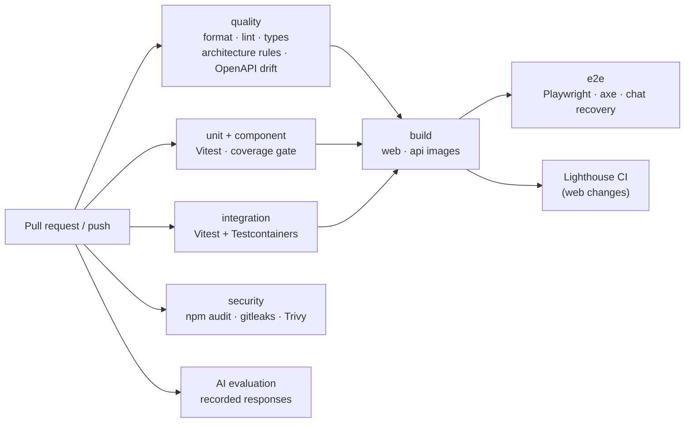
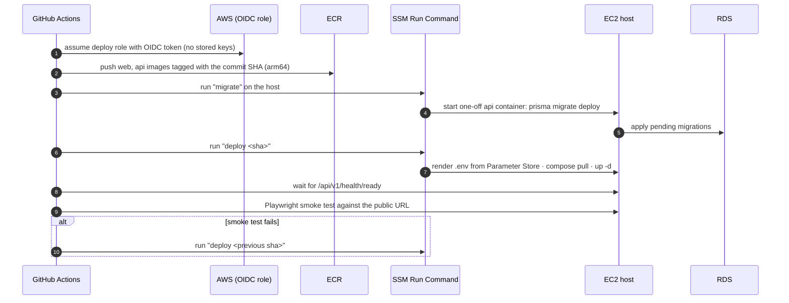

# 06 · Infrastructure and operations

## 1. Local development

### 1.1 Prerequisites

Node.js 26 (from `.nvmrc`), npm 11, Docker with Compose v2.

### 1.2 Services

`docker-compose.yml` runs the infrastructure; the applications run on the host with hot reload. A Caddy container gives the browser **one origin**, exactly as in production, so cookies, WebSockets and server-sent events behave the same locally.

| Service                          | Image                    | Port on your machine                | Purpose                                                                                                                                                                        |
| -------------------------------- | ------------------------ | ----------------------------------- | ------------------------------------------------------------------------------------------------------------------------------------------------------------------------------ |
| proxy                            | `caddy:2`                | **3300** (open this in the browser) | Routes `/api/*` and `/realtime` to the API, everything else to the web app                                                                                                     |
| web (host)                       | —                        | 3301                                | `next dev`                                                                                                                                                                     |
| api (host)                       | —                        | 4301                                | NestJS API                                                                                                                                                                     |
| worker (host)                    | —                        | —                                   | NestJS worker: outbox relay and BullMQ consumers (`npm run dev:worker -w @opspilot/api`, started by `npm run dev`)                                                             |
| postgres                         | `postgres:18-alpine`     | 5443                                | Database (`opspilot`; tests use their own containers). PostgreSQL 18 images keep data under `/var/lib/postgresql/18/docker`, so the volume is mounted at `/var/lib/postgresql` |
| valkey                           | `valkey/valkey:9-alpine` | 6392                                | Queues, rate limits, pub/sub                                                                                                                                                   |
| s3                               | `chrislusf/seaweedfs`    | 8333                                | S3-compatible object storage (added in milestone 3, with the first upload)                                                                                                     |
| mailpit                          | `axllent/mailpit`        | 1036 (SMTP), 8036 (inbox UI)        | Captures every email sent locally (added in milestone 2, with the first email)                                                                                                 |
| lgtm _(profile `observability`)_ | `grafana/otel-lgtm`      | 3310 (Grafana), 4318 (OTLP/HTTP)    | Traces, metrics, dashboards and alerts, standing in for Grafana Cloud (`npm run observability:up`; set `OTEL_EXPORTER_OTLP_ENDPOINT=http://localhost:4318`)                    |

Ports are chosen so OpsPilot can run beside the course projects on the same machine. Every port is bound to `127.0.0.1` and can be overridden in `.env`. Images are pinned to exact versions in the compose file; the table shows only the series. A service joins the compose file in the milestone that first uses it, so every service in it is exercised by code and tests.

On Linux, containers reach the applications on the host through `host.docker.internal` (mapped to the Docker bridge), which cannot reach ports bound to `127.0.0.1`; bind the applications to `0.0.0.0` there (`API_HOST=0.0.0.0`, and `--hostname 0.0.0.0` in the web app's `dev` script) and keep a firewall in front of the machine. Docker Desktop on macOS and Windows needs no change.

### 1.3 Everyday commands

| Command                    | What it does                                                                                            |
| -------------------------- | ------------------------------------------------------------------------------------------------------- |
| `npm run services:up`      | Start the services and wait until all health checks pass                                                |
| `npm run services:down`    | Stop the services; database data is kept in a named volume                                              |
| `npm run observability:up` | Start Grafana with Tempo, Prometheus and Loki (profile `observability`), with the dashboards and alerts |
| `npm run db:migrate`       | Apply migrations to the development database                                                            |
| `npm run db:seed`          | Load the demo workspace and sample events                                                               |
| `npm run dev`              | Start web, api and worker with hot reload                                                               |
| `npm test`                 | Unit and component tests in every workspace                                                             |
| `npm run test:int`         | API integration tests (starts its own containers)                                                       |
| `npm run test:e2e`         | Production builds plus Playwright                                                                       |
| `npm run check`            | Everything CI's quality job runs: format, lint, types, architecture rules, OpenAPI drift                |
| `npm run stack:up`         | Build the production images and start the production-like stack (section 1.4)                           |
| `npm run test:e2e:stack`   | Playwright, including the smoke tests, against that stack over HTTPS                                    |
| `npm run stack:down`       | Stop the stack; its data and certificate authority are kept in named volumes                            |

### 1.4 Production-like stack

`docker-compose.prod.yml` runs the **production images** with every dependency in a container, behind Caddy over **HTTPS**. Secure cookies, HSTS and mixed-content rules therefore behave exactly as they will in AWS, and CI runs its browser tests against it (section 3). It is its own Compose project (`opspilot-stack`), with its own network, volumes and ports, so it can run beside the development services.

| Address                                   | What                                                                     |
| ----------------------------------------- | ------------------------------------------------------------------------ |
| `https://opspilot.localhost:3443`         | The application (`/api/*` to the API, everything else to the web app)    |
| `https://storage.opspilot.localhost:3443` | Object storage, which browsers upload to with presigned URLs, as with S3 |
| `http://…:3380`                           | Redirects to HTTPS, keeping the path and query                           |
| `http://127.0.0.1:8037`                   | Mailpit's inbox                                                          |

Browsers resolve every `*.localhost` name to this machine. A host name of its own, rather than `localhost`, matters: cookies and HSTS belong to a host, not a port, so the stack's cookies and its one-year HSTS policy never touch development on `localhost:3300`.

**Images.** `infra/docker/Dockerfile` builds two targets for `linux/amd64` and `linux/arm64` (the AWS host is ARM), from a Node.js Alpine base pinned by digest:

- `api`: the compiled API and its production dependencies. The same image runs the API (default command), the worker (`node dist/worker.js`) and the migrations (`node ../../node_modules/prisma/build/index.js migrate deploy`), so what is migrated, served and worked on is always one build. The Prisma CLI is in it because `@prisma/client` declares it as an optional peer, which npm installs.
- `web`: the Next.js standalone server, with only the files the build traced as used.

Both run as the unprivileged `node` user, own none of their files, carry no package manager (npm is removed: nothing installs packages at run time) and start through `tini`, which passes `SIGTERM` on so Node.js shuts down gracefully. In the stack each application container also has a read-only file system (with `/tmp` and the Next.js cache in memory), no Linux capabilities and `no-new-privileges`.

Building for arm64 on an x86 machine works under QEMU, with one catch: QEMU's default CPU model makes Prisma's WebAssembly schema parser panic, so the Dockerfile passes a Graviton model (`QEMU_CPU=neoverse-n1`) to its build steps. CI builds each platform natively.

**Order of start-up.** A one-off `migrate` container applies pending migrations; the API and the worker start only after it exits successfully, so new code never runs against an old schema. If a migration fails, `stack:up` fails and the API and worker are not started.

**Trusting the certificate.** Caddy signs the stack's certificates with its own local authority (`tls internal`). Browsers warn until you trust that authority; the browser tests check the certificate against it themselves. To trust it on macOS:

```bash
docker compose --file docker-compose.prod.yml cp proxy:/data/caddy/pki/authorities/local/root.crt opspilot-stack-root.crt
sudo security add-trusted-cert -d -r trustRoot -k /Library/Keychains/System.keychain opspilot-stack-root.crt
```

On Linux, copy it to `/usr/local/share/ca-certificates/` and run `sudo update-ca-certificates` (Firefox and Chromium keep their own trust store and need it imported there). The authority lives in the `caddy-data` volume, so it survives `stack:down`; `docker compose --file docker-compose.prod.yml down --volumes` removes it with all the stack's data.

## 2. Environments

| Environment | Where                     | Data                                                     | Deployed by                        |
| ----------- | ------------------------- | -------------------------------------------------------- | ---------------------------------- |
| **Local**   | Developer machine         | Seeded, disposable                                       | `npm run dev`                      |
| **CI**      | GitHub Actions runners    | Created per job, destroyed after                         | Each pull request and push         |
| **Demo**    | AWS, London (`eu-west-2`) | Demo workspace reset nightly, plus real events run on it | Pipeline, on every merge to `main` |

There is deliberately one cloud environment. Pull requests are verified in CI against production builds; a staging environment would add cost without catching anything CI does not.

## 3. Continuous integration



- Jobs run in parallel where they do not depend on each other; `npm ci` uses the npm cache keyed by the lock file.
- The same container images built in `build` are used by `e2e` and, after merge, deployed. What was tested is what ships.
- `main` requires every job to pass. A final **CI result** job depends on all the others and fails if any did not succeed, so branch protection requires that one check and never needs updating when jobs are added.
- Actions are pinned to full commit SHAs, and Dependabot proposes weekly updates for npm packages and actions.

**What runs today.** [`.github/workflows/ci.yml`](../.github/workflows/ci.yml) runs quality, unit (with the 90% coverage gate on `domain/` folders), integration, security, and **images**. The images job runs once per platform on a native runner (`linux/amd64`, and `linux/arm64` because the AWS host is ARM): it builds the production images, scans them with Trivy, starts the production-like stack (section 1.4) and runs every Playwright test against it over HTTPS, the smoke tests included. Trivy fails the job on any fixable vulnerability of high or critical severity, and on any secret found in an image; a vulnerability without a fix cannot be acted on, so it is left to Dependabot and the next scan. Those browser tests include the axe checks of every page (WCAG 2.2 AA). On amd64 the job then measures the public event page against its budget (`npm run lighthouse`, [engineering standards, section 9](05-engineering-standards.md)) and keeps the reports as the `lighthouse` artifact. Each browser test starts from fresh rate-limit windows (`e2e/fixtures.ts`): all the suite's traffic reaches the API from one address. The other jobs in the diagram join with the milestones that introduce what they check: AI evaluation in M8, OpenAPI drift with the first generated document.

**Dependency audit.** CI fails on any known vulnerability of moderate severity or above in **production** dependencies. Development tools (linters, test runners, build tools) never reach users and run only on our own inputs, so their advisories are reviewed when Dependabot proposes an update rather than blocking every pull request.

An advisory with no fixed release yet, and reviewed as not reachable by users' input, may be allowed in `audit-allowlist.json`. Each entry gives the advisory, its package, the severity it was reviewed at, the reason, the review date and an expiry date at most 30 days after it. `scripts/audit.mjs` fails CI on any advisory not listed, on an entry that breaks these rules, on an entry past its expiry date or reported at a higher severity (review it again), and on an entry the audit no longer reports (remove it).

## 4. Continuous delivery

Built in milestone 10, once the product is complete ([delivery plan](07-delivery-plan.md)); until then CI proves the production images locally.



- **Immutable images**: tagged with the commit SHA, never `latest`. Rollback means deploying the previous SHA.
- **Migrations before code**, using the expand-and-contract pattern: a migration must work with both the old and the new application version, so a rollback never needs a down-migration.
- **Manual approval** is required for the GitHub `demo` environment only when infrastructure changes are applied.

## 5. AWS infrastructure (Terraform)

```text
infra/terraform/
├── bootstrap/          state bucket, GitHub OIDC provider (applied once)
├── modules/
│   ├── network/        VPC, public subnet for the host, private subnets for RDS
│   ├── database/       RDS PostgreSQL 18, parameter group, backups
│   ├── compute/        EC2 host, instance profile, security group, user data
│   ├── storage/        S3 bucket for assets and exports
│   ├── email/          SES domain identity, DKIM, configuration set
│   ├── registry/       ECR repositories and lifecycle policies
│   ├── github-oidc/    deploy and plan roles trusted by this repository only
│   ├── dns/            Route 53 records
│   └── budgets/        AWS Budgets alerts
└── environments/demo/  wiring and variables for the demo environment
```

| Resource       | Configuration                                                                                                                                   | Why                                                                                 |
| -------------- | ----------------------------------------------------------------------------------------------------------------------------------------------- | ----------------------------------------------------------------------------------- |
| EC2 host       | ARM (Graviton), Amazon Linux 2023, Docker Compose; no SSH key — access through SSM Session Manager                                              | Lowest cost that meets NFR-4; no open SSH port                                      |
| RDS PostgreSQL | Single-AZ, encrypted, 7-day point-in-time recovery, private subnets only                                                                        | Managed backups and patching; the database is never reachable from the internet     |
| Valkey         | Container on the host                                                                                                                           | Holds only reconstructible data (queues, counters); ElastiCache is the upgrade path |
| S3             | Private, Block Public Access on, encryption, lifecycle rules for exports                                                                        | Holding slates are served through short-lived presigned URLs                        |
| SES            | Domain identity with DKIM and a configuration set for bounces                                                                                   | Deliverability and bounce handling                                                  |
| ECR            | Scan on push, keep the last 20 images                                                                                                           | Supply-chain visibility and cost control                                            |
| IAM            | Instance role: pull images, read parameters, use its own bucket, send email. Deploy role: push images, send SSM commands. Plan role: read-only. | Least privilege; GitHub OIDC trust limited to this repository and branch            |
| Budgets        | Alerts at 50%, 80% and 100% of the monthly budget                                                                                               | No surprises                                                                        |

Terraform state lives in an encrypted, versioned S3 bucket with S3-native state locking. Pull requests that touch `infra/` get a `terraform plan` comment; `apply` runs only after merge and approval.

The documented upgrade path when traffic grows: move web, api and worker to **ECS Fargate** behind an **Application Load Balancer**, and Valkey to **ElastiCache**. The application needs no code changes for this ([ADR-0010](adr/0010-aws-deployment.md)).

## 6. Configuration and secrets

- Each process validates its configuration at startup (Zod) and exits with a list of problems if anything is wrong.
- **Locally**: `.env` (git-ignored), created from `.env.example`.
- **On AWS**: secrets are `SecureString` parameters in Systems Manager Parameter Store, encrypted with KMS. The deploy command renders them into an env file readable only by the service user. Nothing secret is baked into images.
- **Rotation**: JWT signing keys support a current and a previous key so rotation does not sign everyone out; webhook secrets rotate per endpoint; database credentials rotate through RDS.
- **AI triage** (`AI_PROVIDER`): `none` by default (suggestions unavailable, Q&A unaffected); `anthropic` with `ANTHROPIC_API_KEY` and `AI_TRIAGE_MODEL` (default `claude-opus-5-5`); `offline` groups identical questions without a model, for development and the production-like stack. The evaluation suite's recorded answers are made with `npm run eval:record -w @opspilot/api`, which calls the real model and costs money (about $0.03 for the six cases): run it after a change to the prompt, the cases or the model, and before a release; CI fails while a recording no longer matches.
- **Webhook encryption key** (`WEBHOOK_ENCRYPTION_KEY`, 32 bytes in base64: `openssl rand -base64 32`) encrypts the endpoints' signing secrets. Without it the API refuses to create endpoints and the worker records each delivery as failed. To rotate it, set the new key and move the old one to `WEBHOOK_ENCRYPTION_KEY_PREVIOUS` on the API and the worker. Every 10 minutes the worker seals secrets still under the old key again with the new one; the secrets stay the same, so receivers notice nothing. Once no `webhook_endpoints.secret_key_id` names the old key, remove it.

## 7. Observability

| Signal  | Tool                                                               | What we look at                                                                                                         |
| ------- | ------------------------------------------------------------------ | ----------------------------------------------------------------------------------------------------------------------- |
| Logs    | pino → OpenTelemetry Collector → Grafana Cloud                     | Errors by route, slow requests, job failures                                                                            |
| Traces  | OpenTelemetry SDK (web server, api, worker) → Grafana Cloud        | One request across services and jobs; slow database queries                                                             |
| Metrics | OpenTelemetry metrics                                              | Request rate, errors and duration per route; queue depth and job age; open real-time connections; stream-check failures |
| Errors  | Sentry (browser, web server, api, worker)                          | New and regressed errors per release                                                                                    |
| Uptime  | External check on `/api/v1/health/ready` and the public event page | Availability                                                                                                            |

**What runs today.** Structured logs (pino, JSON) and Sentry error reporting in every process ([architecture, section 7.9](02-architecture.md#79-observability)), configured by `SENTRY_DSN`, `SENTRY_ENVIRONMENT` (default: `NODE_ENV`) and `SENTRY_RELEASE` (the commit SHA the images are tagged with). Traces (milestone 9): the API and the worker start the OpenTelemetry SDK before anything else (`node --import ./dist/telemetry.js`) and send spans over OTLP/HTTP to `OTEL_EXPORTER_OTLP_ENDPOINT`; tracing is off when it is unset. HTTP, Express routes, PostgreSQL and Valkey are traced automatically, outgoing calls and queries only inside a request or job. Spans leave without query strings or visitor addresses, Valkey commands without their arguments and queries without their values; every log line carries the `trace_id` and `span_id` it was written in. One trace follows a request across processes: the browser's API calls start it with a W3C `traceparent` header (no browser SDK, so the public page's script budget is untouched); the web server traces its own pages and its fetches to the API (its Sentry SDK leaves OpenTelemetry alone); an outbox message stores the trace it was written in, and the relay queues its job in that trace, which the worker continues (`bullmq-otel`). Business operations have spans of their own: `triage.run`, `webhook.send` and `stream.check`, carrying IDs and outcomes, never personal data. Metrics go to the same endpoint every 15 seconds (`OTEL_METRIC_EXPORT_INTERVAL`): `http.server.request.duration` per route and status from the HTTP instrumentation (rate, errors and duration), `opspilot.queue.jobs` and `opspilot.queue.oldest_job_age` per queue, `opspilot.outbox.oldest_message_age`, `opspilot.realtime.connections` per API instance, `opspilot.stream.checks` by outcome and `opspilot.webhook.attempts` per endpoint and outcome. The production-like stack points the DSN at `sentry.invalid`, a name that never resolves, so nothing leaves the machine; its smoke test intercepts what the browser sends there. Locally and in the production-like stack, traces and metrics go to `grafana/otel-lgtm` (Grafana with Tempo, Prometheus and Loki behind an OpenTelemetry Collector), standing in for Grafana Cloud until milestone 10. Its Grafana loads the **OpsPilot overview** dashboard and the four alerts below from `infra/observability/grafana/` (provisioned, not edited by hand), and sends alert emails to Mailpit. The readiness alert reads an `httpcheck` the collector runs against `/api/v1/health/ready` every 15 seconds (`infra/observability/otelcol-readiness.yaml`), as the external uptime check will in AWS. The stack's browser tests check that the rules evaluate, that every dashboard query runs, and that a click in the browser yields one trace spanning the API and the worker.

**Service level objectives** for the demo environment:

| Objective                                     | Target             |
| --------------------------------------------- | ------------------ |
| Availability of the public event page and API | 99.5% per month    |
| Chat delivery latency                         | 95% under 1 second |
| Stream outage visible in the operations room  | Within 60 seconds  |

**Alerts** (email): 5xx rate above 2% for 5 minutes, readiness check failing for 2 minutes, oldest queued job older than 5 minutes, webhook deliveries failing for one endpoint more than 10 times in an hour.

## 8. Backups and recovery

| Item           | Approach                                                                                                               | Targets                                                                 |
| -------------- | ---------------------------------------------------------------------------------------------------------------------- | ----------------------------------------------------------------------- |
| Database       | RDS automated backups with point-in-time recovery; manual snapshot before each migration that changes or drops columns | Recovery point within 5 minutes; recovery time under 1 hour             |
| Object storage | S3 versioning on the asset bucket                                                                                      | Undo accidental deletes for 30 days                                     |
| Valkey         | Not backed up                                                                                                          | Queues are rebuilt from the outbox; counters and presence are ephemeral |
| Infrastructure | Terraform state, versioned                                                                                             | Rebuild from code                                                       |

Restores are rehearsed once before the public demo, following the runbook.

## 9. Runbooks

Each runbook lives in `docs/runbooks/` ([index](runbooks/README.md)) and follows the same shape: **symptoms → checks → actions → verification**, with a section for the local stack and one for AWS. Each was rehearsed on the local stack in milestone 9, and the rehearsal is logged at its end.

| Runbook                                                                 | When                                    |
| ----------------------------------------------------------------------- | --------------------------------------- |
| [Deploy and roll back](runbooks/deploy-and-roll-back.md)                | Every release; failed smoke test        |
| [Restore the database to a point in time](runbooks/restore-database.md) | Data loss or corruption                 |
| [Rotate a secret](runbooks/rotate-a-secret.md)                          | Suspected leak; scheduled rotation      |
| [Webhook endpoint failing](runbooks/webhook-endpoint-failing.md)        | Delivery alert                          |
| [Stream check reports false outages](runbooks/stream-false-outages.md)  | Incidents opened while the stream plays |
| [Demo reset failed](runbooks/demo-reset-failed.md)                      | Demo workspace not reset by 06:00       |

## 10. Demo mode

The demo environment runs with `DEMO_MODE=true`:

- **One-click sign-in** to the demo workspace as a Manager, with a banner explaining that data resets nightly.
- **Emails are captured, not sent**: messages to demo attendees appear in an in-app **demo inbox**, so a visitor can complete registration and verification without a real mailbox.
- **Webhooks** are not part of the demo: they are managed by Owners, and visitors are the demo's Manager, so the Integrations screen is not offered to them (and the API refuses them). This keeps the demo from sending requests to addresses visitors choose.
- **AI triage** has a daily budget: 30 runs or $1, whichever comes first, per UK calendar day; when it is spent, the panel says so and Q&A carries on normally. Real workspaces have none unless `TRIAGE_DAILY_BUDGET_USD` is set.
- **Nightly reset** at 03:00 UK time restores the seed data; real workspaces are never touched.

**What runs today** (milestone 4):

- `POST /auth/demo` signs a visitor in as the demo workspace's Manager ("Demo Visitor"); the sign-in page shows **Try the demo** when the web server runs with `DEMO_MODE=true`, and every page in the demo workspace carries the banner. The first sign-in creates the workspace, so a new environment needs no manual step.
- The seed (`apps/api/src/demo/domain/demo-seed.ts`) is dated from the moment it is written: an event being prepared with blockers left to clear, a draft, one that ran last week and an archived one. None is READY or LIVE, because those promise a recent stream check.
- The worker resets the workspace with a BullMQ job scheduler at `0 3 * * *` in `Europe/London`, so it follows British Summer Time. The reset deletes everything in the demo workspace (events with everything they own, invitations, audit entries, outbox messages, stored idempotent responses and the files of holding slates), restores its three people and their roles, and writes the seed again; visitors stay signed in. When a reset commits, the workspace is exactly the seed: it waits for edits and event creates in progress and then deletes their result (creates take the demo workspace's lock, which the reset holds throughout), and a create that arrives while it runs waits for it and commits after it, so that event stays until the next night. Upload links handed out before a reset work for a few more minutes, so the reset also records the deleted events' storage prefixes in `pending_file_purges`, in its own transaction: once every such link has expired, the worker's sweep (every 5 minutes, demo mode or not) deletes those files again and then the record; while storage is down the record stays, and every later sweep tries again. With demo mode off, the worker removes the schedule. `npm run db:seed` runs the same reset at once.
- Anyone can be the demo's Manager, so what a visitor can make it do is bounded: at most 40 events and 50 holding slates (each up to 5 MB) until the next reset (`403 DEMO_RESTRICTED` after that), 300 changes an hour from one address and 3,000 from everyone together (`429` after that, and `503` while Valkey cannot count them, rather than no limit; reading goes on), no stream URL (stream checks fetch whatever address is entered, every 30 seconds, so the demo could be pointed at any public site), and at most 1,000 live demo sessions (a sign-in ends the oldest beyond that, and any that have expired).
- The demo people's addresses are under `demo.opspilot.invalid`. The reserved `.invalid` top-level domain cannot receive email, so request schemas refuse it (nobody can register, invite or reset the password of a demo account), and the mailer never sends to it: the demo sends no real email and earns no bounce. Their passwords are hashes of random secrets nobody knows.
- **The demo inbox**: in the demo workspace no attendee mail is sent. Registering sets a random `__Host-opspilot_demo_inbox` key in the browser, and each message is stored with the hash of the key of the browser that registered: `GET /public/demo-inbox` shows that browser its own mail only, so a visitor can register with any address, verify and join, and nobody receives mail they did not ask for. The demo holds at most 200 attendees until the next reset; a registration beyond that is answered like any other (`202`) and does nothing. Each attendee keeps their newest 10 demo inbox messages, one unused link and 5 sessions, so registering one address again and again, from any number of places, grows nothing.
- The past events (the conference that ran last week and the archived webinar) have reports from the moment they are seeded, with no audience: open one and choose **Report**.
- AI triage spend is kept in `triage_spend`, per workspace and UK day, apart from the runs, so the nightly reset gives nothing back. Each start counts its rate limit first (so a slow Valkey holds up one event, not the workspace), then locks the day's row, checks the limit against what was spent plus what running runs reserve plus its own worst cost, and reserves that; the reservation becomes the real cost when the run ends (`TRIAGE_BUDGET_SPENT` once spent).
