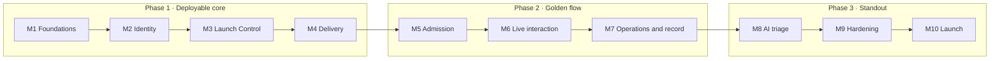

# 07 · Delivery plan

OpsPilot is delivered in three phases and ten milestones. Each milestone ends with a working, deployed (from Milestone 4 onwards) system and has exit criteria that can be checked. Requirement IDs refer to [Product requirements](01-product-requirements.md).

This repository is the **reference implementation**: each milestone is built and verified here first, then taught as a series of lessons in which the learner builds the same milestone in their own repository.

## Overview

| Phase               | Outcome                                                                                        | Indicative length at three sessions a week |
| ------------------- | ---------------------------------------------------------------------------------------------- | ------------------------------------------ |
| 1 · Deployable core | Staff can sign up, prepare an event and get a trustworthy readiness verdict, on AWS with CI/CD | 7–9 weeks                                  |
| 2 · Golden flow     | Attendees register, watch, chat and ask; staff run the event and get a report                  | 5–7 weeks                                  |
| 3 · Standout        | AI triage with evaluations, observability, load and accessibility evidence, launch materials   | 3–4 weeks                                  |

## Phase 1 · Deployable core

### M1 · Foundations

- **Scope**: npm workspaces monorepo on Node.js 26; TypeScript 6.0, ESLint, Prettier, dependency-cruiser; `packages/contracts` with the first schemas and error codes; NestJS 12 API skeleton with configuration validation, problem responses and health endpoints; Next.js 16 app shell; Docker Compose with Caddy, PostgreSQL and Valkey (Mailpit joins in M2, SeaweedFS in M3, each with its first use); readiness checks against PostgreSQL and Valkey; Vitest in every workspace; GitHub Actions quality and test jobs.
- **Exit criteria**: `npm run services:up && npm run dev` serves the web app and `GET /api/v1/health/ready` through one origin on port 3300; CI is green and required on `main`.
- **Teaching notes**: Docker and Compose are learned first in the separate learning folder, then applied here. The course repository started on Node 22, TypeScript 5.9, NestJS 11, Jest and CommonJS; this milestone includes upgrading it to the reference stack (Node 26, TypeScript 6.0, NestJS 12 with ES modules, Vitest), which is itself a realistic exercise.

### M2 · Identity and tenancy

- **Scope**: Mailpit in Docker Compose; Prisma 7 schema and migrations for users, workspaces, memberships, sessions and tokens; FR-WS-1 to FR-WS-4; FR-AUTH-1 to FR-AUTH-4; guards for authentication, workspace and role; rate limiting; sign-in, sign-up, password reset, team and invitation screens.
- **Exit criteria**: integration tests prove refresh-token rotation under concurrency, immediate effect of role changes, and no cross-workspace access; Playwright covers sign-up → invite → accept → sign in.

### M3 · Events and Launch Control

- **Scope**: SeaweedFS in Docker Compose; FR-EV-1 to FR-EV-4, FR-LC-1 to FR-LC-4, FR-ST-1 to FR-ST-3; lifecycle and readiness as pure domain functions; outbox and worker skeleton; stream-check job and incidents; presigned upload of the holding slate; Launch Control and event list screens.
- **Exit criteria**: unit tests cover every readiness rule and transition; a race test proves two concurrent "go live" requests cannot bypass a blocker; the stream check opens and resolves incidents against a controllable test stream.

### M4 · Delivery

- **Scope**: production Dockerfiles (multi-stage, non-root, arm64); Terraform for the AWS demo environment; GitHub OIDC; deploy pipeline with migrations, smoke test and rollback; Sentry and structured logs; demo mode with seed data, one-click sign-in and nightly reset (FR-AUTH-5).
- **Exit criteria**: a merge to `main` reaches the demo environment with no manual step; a deliberately failing smoke test rolls back automatically; a visitor can sign in to the demo with one click.
- **Career milestone**: the full-stack CV goes out with a live link from here.

## Phase 2 · Golden flow

### M5 · Admission

- **Scope**: FR-AD-1 to FR-AD-6; server-rendered public event page with metadata; registration and verification; access policies and invitations; attendee sessions with per-request eligibility; reminder scheduling; consent recording, retention job and erasure; the demo inbox.
- **Exit criteria**: the public page meets the NFR-3 budget in Lighthouse CI; tests prove no account enumeration, single-use tokens, at-most-once reminders and anonymisation.

### M6 · Live interaction

- **Scope**: FR-RN-1 to FR-RN-5; Socket.IO gateway with the Valkey adapter; sequence journals and catch-up; chat and Q&A with moderation; watch page with hls.js and the holding-slate switch; attendance heartbeats; revocation within 5 seconds.
- **Exit criteria**: Playwright forces a network interruption and proves no lost or duplicated messages; database-enforced pin limit and vote uniqueness hold under concurrent requests.

### M7 · Operations and record

- **Scope**: FR-RN-7, FR-RC-1 to FR-RC-3; operations room over server-sent events with charts; webhook endpoints, signing, retries and the integrations screen; audit search; post-event report and CSV export.
- **Exit criteria**: a webhook receiver test verifies signatures and de-duplication; the report matches hand-calculated figures for a seeded event.

## Phase 3 · Standout

### M8 · AI question triage

- **Scope**: FR-RN-6; provider interface with the Vercel AI SDK; structured output validated against question IDs; moderator review and merge; cost and latency recording; daily budget in demo mode; evaluation suite.
- **Exit criteria**: the evaluation suite runs in CI on recorded responses and meets its agreed score; provider failure and timeout leave Q&A fully usable.

### M9 · Hardening

- **Scope**: end-to-end OpenTelemetry tracing including jobs; dashboards and alerts; k6 load test for NFR-4; full accessibility audit with a keyboard walkthrough; security review against the checklist and OWASP ASVS areas in scope; runbooks; database restore rehearsal.
- **Exit criteria**: load test results and Lighthouse scores recorded in the repository; every runbook exercised once.

### M10 · Launch

- **Scope**: README with architecture diagram, live link, demo instructions and trade-offs; final ADR review; a two-minute demo video; a real small online event run on OpsPilot, with its report.
- **Exit criteria**: a reviewer who has never seen the project can understand, run and try it from the README alone.

## Risks

| Risk                                                                                      | Likelihood | Impact               | Mitigation                                                                                                       |
| ----------------------------------------------------------------------------------------- | ---------- | -------------------- | ---------------------------------------------------------------------------------------------------------------- |
| Scope grows during the build                                                              | High       | Delays the live demo | Requirements are fixed per milestone; new ideas go to a backlog, not into the current milestone                  |
| A recent major (Node.js 26, NestJS 12, Vitest 5, AI SDK 7, PostgreSQL 18) has rough edges | Medium     | Slower progress      | Verify each in the learning folder before adopting; pin exact versions; record workarounds in ADRs               |
| AWS cost creeps up                                                                        | Medium     | Unexpected bills     | Single instance, Budgets alerts, no NAT gateway, image lifecycle rules                                           |
| Real-time features are hard to test reliably                                              | Medium     | Flaky CI             | Deterministic sequence-based protocol; controlled network interruption in Playwright; no timing-based assertions |
| AI provider changes or fails                                                              | Medium     | Triage unavailable   | Provider-agnostic SDK, strict fallback, recorded responses for CI                                                |
